# Check Point SD-WAN with Smart-1 Unified Management: Hands-On Lab Guide

<a href="https://checkpointsw-devsec.github.io/DemoLab-Guides/PlayBooks/SD-WAN/" target="_blank" rel="noopener noreferrer">Open HTML Version (open in a new Tab)</a>

In this virtual lab environment, you get access to two WAN lines. One of them can be used to simulate an MPLS line.
**Spoiler Alert**: One place to manage it all: SmartConsole.

In this lab, you steer traffic across several WAN links with Check Point software-defined wide area network (SD-WAN). You run the whole deployment from SmartConsole on an on-premises Management Server. No Portal is involved.

## What you will learn

- Enable SD-WAN objects on an on-premises Management Server
- Prepare gateway routing so local and overlay traffic fail over cleanly
- Enable the SD-WAN Software Blade and map interfaces to WAN links
- Create the SD-WAN Policy and read its default rules
- Build the VPN and Access Control rules that the overlay needs
- Prove steering works with logs, CPView, and the SD-WAN command line
- Turn one public link into a private MPLS line and watch the tunnel count change
- Fail over a WAN link and watch SD-WAN react

## Contents

- [Check Point SD-WAN with Smart-1 Unified Management: Hands-On Lab Guide](#check-point-sd-wan-with-smart-1-unified-management-hands-on-lab-guide)
  - [What you will learn](#what-you-will-learn)
  - [Contents](#contents)
  - [How SD-WAN works in 60 seconds](#how-sd-wan-works-in-60-seconds)
  - [Before you start](#before-you-start)
    - [Lab access](#lab-access)
    - [Lab setup](#lab-setup)
    - [Lab values](#lab-values)
  - [Part 0: Get familiar with the environment](#part-0-get-familiar-with-the-environment)
  - [EA Part 0: Enable SD-WAN Blade on the Gateway Objects](#ea-part-0-enable-sd-wan-blade-on-the-gateway-objects)
  - [Part 1: Prepare gateway networking](#part-1-prepare-gateway-networking)
    - [hq-exl](#hq-exl)
    - [branch-gw](#branch-gw)
  - [Part 2: Enable SD-WAN on hq-exl and branch-gw](#part-2-enable-sd-wan-on-hq-exl-and-branch-gw)
    - [2.1 Enable the blade and the interfaces on hq-exl](#21-enable-the-blade-and-the-interfaces-on-hq-exl)
    - [2.2 Repeat on branch-gw](#22-repeat-on-branch-gw)
    - [2.3 SD-WAN objects](#23-sd-wan-objects)
    - [2.4 SD-WAN Steering Object](#24-sd-wan-steering-object)
  - [Part 3: Create the SD-WAN Policy](#part-3-create-the-sd-wan-policy)
    - [Read the default rules](#read-the-default-rules)
  - [Part 4: Configure VPN and Access Control for the overlay](#part-4-configure-vpn-and-access-control-for-the-overlay)
    - [4.1 Set the Star community for the overlay](#41-set-the-star-community-for-the-overlay)
    - [4.2 Review the overlay probing rule](#42-review-the-overlay-probing-rule)
  - [Part 5: Install and validate](#part-5-install-and-validate)
    - [5.1 Install](#51-install)
    - [5.2 Read probing results in CPView](#52-read-probing-results-in-cpview)
    - [5.3 Check the tunnels](#53-check-the-tunnels)
    - [5.4 Test the traffic](#54-test-the-traffic)
  - [Part 6: Backhaul Verification](#part-6-backhaul-verification)
  - [Part 7: Change Tunnel Peering by using circuits](#part-7-change-tunnel-peering-by-using-circuits)
    - [7.1 Create the MPLS WAN Link and circuit](#71-create-the-mpls-wan-link-and-circuit)
    - [7.2 Move `eth3` to the MPLS WAN Link](#72-move-eth3-to-the-mpls-wan-link)
    - [7.3 Observe](#73-observe)
  - [Part 8: Fail over](#part-8-fail-over)
    - [Exercise: check VPN peer status](#exercise-check-vpn-peer-status)
    - [If you need more](#if-you-need-more)
  - [Optional challenges](#optional-challenges)
    - [Check that Threat Prevention still sees overlay traffic](#check-that-threat-prevention-still-sees-overlay-traffic)
  - [Cheat sheet](#cheat-sheet)
  - [Reference](#reference)


| | |
|---|---|
| **Management model** | Smart-1 Unified Management (SD-WAN objects, gateway settings, and SD-WAN Policy live in SmartConsole) |
| **Release** | R82.20 |
| **Suggested time** | Three hours, including one break. Adjust after your first pilot run |
| **Level** | Familiar with SmartConsole, Gaia, and Site-to-Site VPN |
| **Admin guide (EA)** | [Check Point SD-WAN - Smart-1 Unified Management R82.20 Administration Guide](https://sc1.checkpoint.com/documents/SD-WAN-with-Smart1/Content/Topics-SD-WAN-Smart-1/1_Introduction.htm) |


## How SD-WAN works in 60 seconds

SD-WAN picks the best WAN link for each connection. It measures link quality (latency, jitter, and packet loss) and applies your SD-WAN Policy. You don't need dynamic routing for this.

Three traffic types matter in this lab:

| Use case | What it does | Lab example |
|---|---|---|
| **Local Breakout** | Sends Internet traffic out through the best local ISP | hq-client browsing to the Internet |
| **Overlay** | Picks the best VPN tunnel between SD-WAN peers | hq-client reaching the web server at the branch |
| **Backhaul** | Sends branch Internet traffic through the headquarters over the VPN | branch-client browsing to a backhauled site (Part 6) |

The management path is simple: the Management Server installs the SD-WAN Policy with the Access Control policy. The SD-WAN process on each gateway then enforces it.

---

## Before you start

### Lab access

Your trainer gives you the login details for every lab machine through the lab portal. Keep them there. Don't type them into notes, scripts, or browser password stores, and don't paste them into this guide.

### Lab setup 

| Component | Gaia version used in this LAB|
|---|---|
| Management Server | R82.20 |
| Security Gateway or ClusterXL | R82.20 |
| Spark Firewall (if your topology includes one) | R82.00.11 |

> **:pushpin: Note for Policy Packages Installation**: The SD-WAN Policy is a shared Policy and gets installed on Gateways as part of the Access Control policy installation. If a new or modified Access Control install fails on any gateway in the run, the SD-WAN Policy is also not enforced. 

### Lab values

During the lab, you need additional information based on the topology of this lab.
- [Lab network topology](https://checkpointsw-devsec.github.io/DemoLab-Guides/PlayBooks/Shared-Books/index.html)

| Item | Value |
|---|---|
| hq-exl, ISP1 interface | `eth2`, 10.160.11.10 <br>next hop 10.160.11.254 |
| hq-exl, ISP2 interface | `eth3`, 10.160.12.10 <br>next hop 10.160.12.254 |
| branch-gw, ISP1 interface | `eth2`, 10.160.31.1 <br>next hop 10.160.31.254 |
| branch-gw, ISP2 interface | `eth3`, 10.160.32.1 <br>next hop 10.160.32.254 |
| HQ VPN domain | `net_192.168.30.0_24` |
| Branch VPN domain | `net_172.30.1.0_24` |
| Web server (branch-linux) | 172.30.1.60 |

</div>

---

## Part 0: Get familiar with the environment

Time: 15 minutes

In this part, you get familiar with the lab environment and deploy the policy packages for the lab.

1. Open SmartConsole from the management client
2. Open **Gateways & Servers** and confirm that hq-exl and branch-gw show a healthy status

<div align="center">


</div>

3. Open **Security Policies** and review the Access Control rule base on both gateways' policy packages

> The lab cleanup rule accepts all traffic. The data center and branch office policy packages become available after you run the prepared AWX workflow.

- **Policy Package**

To get the policy packages for this lab:

Open the Firefox browser and click the prepared AWX (Ansible Works) bookmark.

<div align="center">


</div>

For credentials, see [Lab network topology](https://checkpointsw-devsec.github.io/DemoLab-Guides/PlayBooks/Shared-Books/index.html)


Go to **Templates** and launch "Flow-SD-WAN".

<div align="center">


</div>


The Ansible scripts are synced from the master repository on GitHub

<a href="https://github.com/checkpointsw-devsec/DemoLab-Guides/tree/main/Lab-Code" target="_blank" rel="noopener noreferrer">Open github-URL</a>

to the GitLab instance installed in this lab environment.

The flow output shows the playbooks used in this flow. `tmp` is the abbreviation for Template:
- tmp_objects (definition of the Objects that are used by Community or Policy packages)
- tmp_VPN-Community (definition of the VPN Community Object)
- tmp_branch-rules (definition of the rules for branch-Office Policy Package)
- tmp_DC-Rules(definition of the rules for Data Center Policy Package)

<div align="center">

  

</div>

After a successful run of "Flow-SD-WAN", the objects used in this lab are available in SmartConsole.

Please check Policy packages:

<div align="center">


</div>

For more information about AWX or GitLab, see: [GitLab](https://github.com/checkpointsw-devsec/DemoLab-Guides/blob/main/PlayBooks/Shared-Books/GitLab.md) [AWX](https://github.com/checkpointsw-devsec/DemoLab-Guides/blob/main/PlayBooks/Shared-Books/AWX.md)

4. Open **VPN Communities** named Bra_DC_Community and check or set these settings in the Star community:

- On the **Gateways** page, center has to be **hq-exl-gw**
- Satellite gateway: **branch-gw**
- Set the routing bsed on defined  domains `Domain Based` and set it "To center and to other satellites through center"
- On **Access Control Policy > Properties**, note whether NAT is disabled inside the community
- On **Encryption**, note the IKE version

5. Check the VPN domains and Link Selection:

- Open hq-exl-gw: set the `VPN domain` to `net_192.168.30.0_24`
- Open branch-gw: set the `VPN domain` to `net_172.30.1.0_24`
- In each gateway, open **IPSec VPN > Link Selection** and note the primary interface

> **Why Link Selection matters.** Link Selection decides which interface and IP address a gateway uses for each VPN tunnel. This matters most when a gateway has several ISP links, cloud VPN peers, or third-party IPsec peers. With **Enhanced Link Selection**, each link becomes its own VPN path: the gateways can build separate IPsec tunnels between those interfaces and spread connections across them. Confirm that **Enhanced Link Selection** is selected on both gateways.

Install the `SD-WAN-DC` and `SD-WAN-Branch` policy packages and check the traffic from hq-client:

- Browse to an Internet site (https://bbc.com)
- Browse to `http://172.30.1.60` (the web server at the branch)

<div align="center">


</div>

- In **Logs & Events**, search for `dst:172.30.1.60` and confirm you see an Encrypt log

> **Expected result:** both sites load, and the Encrypt log shows the VPN path. 
> You should see at least two log entries to 172.30.1.60.

You have a working VPN but no SD-WAN yet.

---

<details>
<summary><strong>During EA Phase</strong></summary>

## EA Part 0: Enable SD-WAN Blade on the Gateway Objects

**This section has been prepared since it will be fulfilled in the GA!**

> SD-WAN configuration capabilities in EA Phase stay hidden in SmartConsole until you switch them on at the Management Server. Do this before anything else.

- Open an SSH session to the Management Server and log in to Expert mode
- Check the Web SmartConsole package version:

```bash
autoupdatercli show web_console -f json | jq -r '[.. | objects | select((."package-installed"|tostring)=="true") | ."package-version"] | "Web SmartConsole version is: \(max)"'
```

- If the version is lower than 176, update the package:

```bash
autoupdatercli update_component web_console
```

- Check the current file so you don't add duplicate entries:

```bash
cat $FWDIR/conf/mwc.env
```

- Add the two parameters, but only if they aren't already in the file:

```bash
echo FF_SD_WAN=1 >> $FWDIR/conf/mwc.env
echo CF_SD_WAN=1 >> $FWDIR/conf/mwc.env
```

- Restart the Web SmartConsole component:

```bash
wsc restart
```

> Restarting can disconnect active Web SmartConsole sessions. 

- Reconnect with SmartConsole
- Go to **Security Policies** and look in the **Shared Policies** section

> **Expected result:** the **SD-WAN Policy** entry appears under Shared Policies.

</details>

---

## Part 1: Prepare gateway networking

Time: 20 minutes

SD-WAN builds on the gateway's own routing table. Set that foundation first.

Gateway-originated traffic follows the Gaia routing table, not SD-WAN rules. SD-WAN never changes that table. If ISP1 fails and your default route still points at ISP1, the gateway itself loses its connection even while user traffic fails over.

So each ISP gets its own default route with its own priority. A lower number wins. No priority means priority 0, the highest preference.

**Licensing.** Each SD-WAN gateway needs an SD-WAN subscription associated in the User Center and attached to the gateway. Your trainer has already attached the lab licenses. After Part 2, SD-WAN should appear in the list of enabled Software Blades on each gateway.


Next, check the BGP peers and the existing routes.

### hq-exl

- Open the Gaia Web portal for hq-exl, or connect over SSH and open Gaia Clish (gclish)
- Review the current routes:

```clish
show configuration bgp 
```

<div align="center">


</div>


```clish
show configuration routemaps
```
<div align="center">


</div>

```
show route all
```

<div align="center">


</div>

We've defined the preferences to each ISP in the route maps. 
All routes are advertised by the "ISP" routers, here named as VYOS1 and VYOS2.


Add only what is missing:

```clish
set bgp external remote-as 64529 peer 10.160.11.254 ip-reachability-detection on
set bgp external remote-as 64539 peer 10.160.12.254 ip-reachability-detection on
save config
```
:memo: in case of static routing the equivalent command is: `set static-route default ping on`
> If hq-exl runs as a clusterXL in your topology, repeat this on every cluster member. 
 
**Expected result:** `show route` lists two default routes with different preferences, and both next hops answer.

:memo: The Automatic Next Hop feature, which you configure on the interfaces of the Security Gateway object, also uses these routes.

> **Best Practice** : Enable next-hop monitoring, such as ping on, and consider IP Reachability Detection so that a route remains active only when the path is reachable. 
> - Choose dedicated monitoring target(s) as the number of your ISPs. 
> - Set static route for each monitoring target to get routed through the monitored ISP only. 
> - Attach the monitoring targets to the ISP routes. 
> - Do not attach monitoring targets to the last-resort ISP route (the route with the lowest preference).

### branch-gw

- Connect to branch-gw and open Gaia Clish
- Add only what is missing:

```clish
set bgp external remote-as 64529 peer 10.160.31.254 ip-reachability-detection on
set bgp external remote-as 64539 peer 10.160.32.254 ip-reachability-detection on
save config
```

---

## Part 2: Enable SD-WAN on hq-exl and branch-gw

Time: 40 minutes

### 2.1 Enable the blade and the interfaces on hq-exl
| Interface | WAN Link | Next hop |
|---|---|---|
| `eth2` | `WAN1` | 10.160.11.254 |
| `eth3` | `WAN2` | 10.160.12.254 |

- Go to **Gateways & Servers** and open hq-exl
- Select the **SD-WAN** Software Blade

<div align="center">

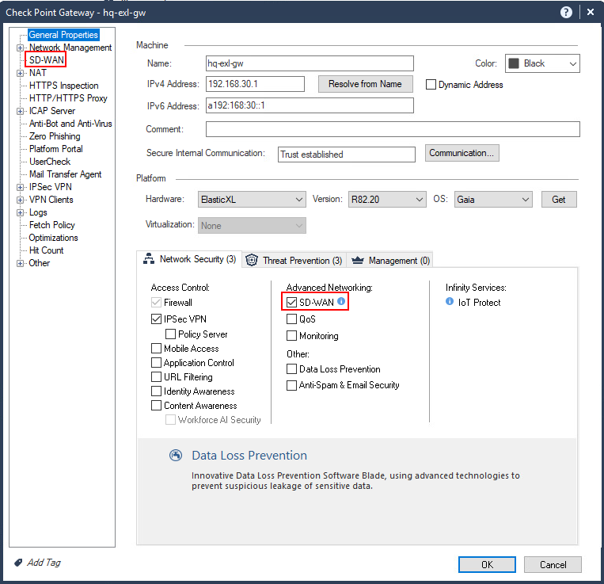

</div>

- Open **Network Management** and confirm that `eth2` and `eth3` use the topology **External**
- Compare the interface names with the names in Gaia

<div align="center">

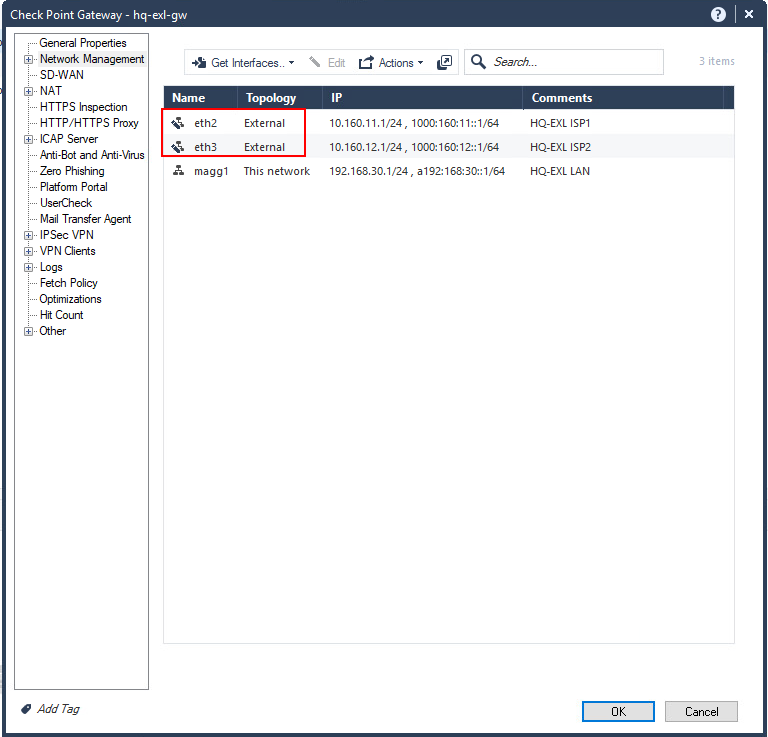

</div>

> Interface names must match in three places: the Gaia OS, the gateway object's Network Management page, and the installed SD-WAN policy. A mismatch is the most common reason an expected tunnel is missing. In a cluster, the Cluster Virtual Interface names must match the member interface names too.

- Edit `eth2`, then open its **SD-WAN** menu
- Enable SD-WAN on the interface and map it to WAN Link `WAN1`

<div align="center">

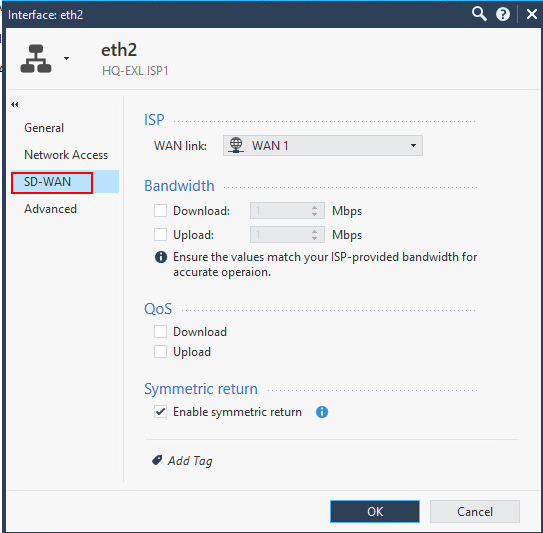

</div>

- Go to the `eth2` **Network Access** menu
- Set the next hop mode to **Custom** and enter 10.160.11.254

<div align="center">

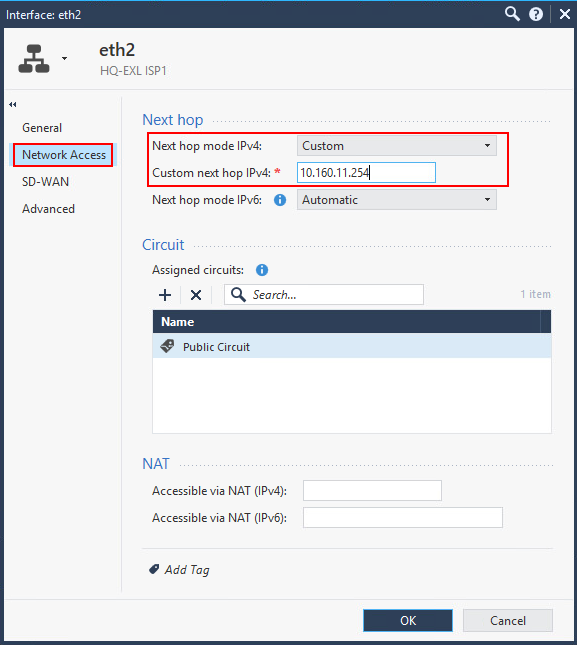

</div>

- Click **OK**

- Edit `eth3`, then open its **SD-WAN** tab
- Enable SD-WAN and map it to WAN Link `WAN2`

<div align="center">

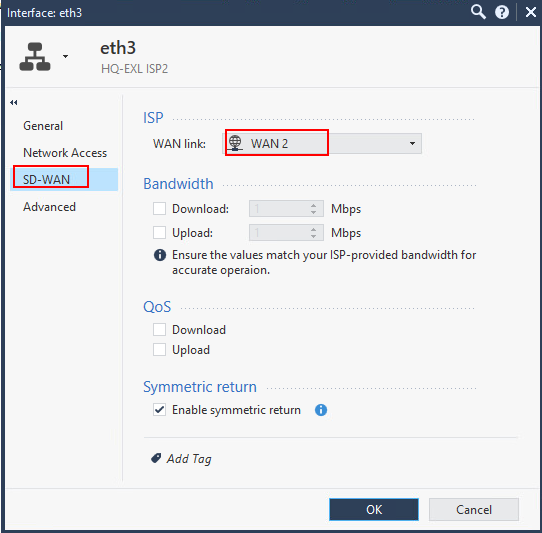

</div>

- Go to the `eth3` **Network Access** menu
- Set the next hop mode to **Custom** and enter 10.160.12.254

<div align="center">

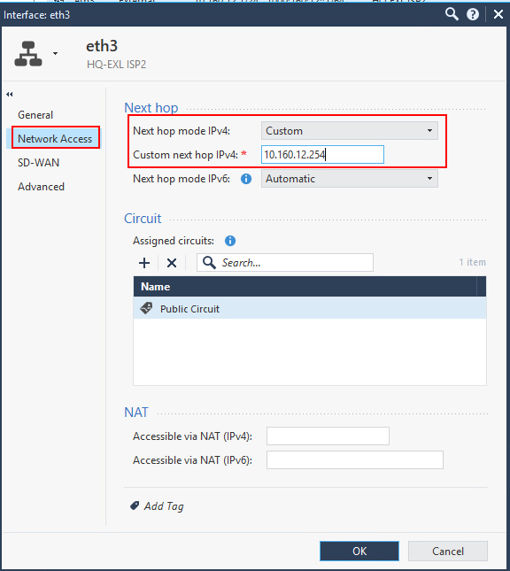

</div>

- Leave **Symmetric Return** at its default
- Click **OK**

- Go to the gateway's **SD-WAN** menu. It shows an overview of the WAN Link mappings, next hops, and circuits per interface.
<div align="center">

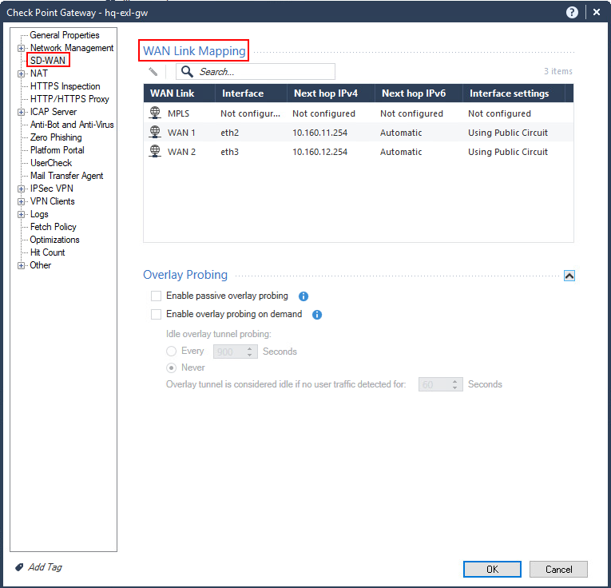

</div>

- Click **OK**

### 2.2 Repeat on branch-gw

| Interface | WAN Link | Next hop |
|---|---|---|
| `eth2` | `WAN1` | 10.160.31.254 |
| `eth3` | `WAN2` | 10.160.32.254 |

- Open branch-gw and enable the **SD-WAN** Software Blade
- Enable SD-WAN on `eth2` and `eth3` with the values above
- Use a custom next hop IPv4 address

- **Publish** the session

> **Try it later:** Automatic Next Hop reads the next hop from the Gaia routing table, which is another reason Part 1 matters. If it can't find a valid route, set the next hop to Custom. If Auto fails and a WAN Link is the only source in a steering object, policy installation can fail.

> **Expected result:** both gateways show SD-WAN enabled, and the session is published.

> Both Internet links share one circuit. That is why every interface pair forms a tunnel. You change this in Part 7.

### 2.3 SD-WAN objects

For custom objects please refer to the SD-WAN documentation.

The three main object types are:

| Object | What it is |
|---|---|
| **Circuit** | A WAN domain. Overlay tunnels form only between interfaces that share a circuit |
| **WAN Link** | An SD-WAN object mapped to a gateway interface. Public (Internet) or private (MPLS) |
| **Steering Object** | Defines how traffic is routed over the available WAN Links based on policies and conditions |

[SD-WAN Objects and Topology](https://sc1.checkpoint.com/documents/SD-WAN-with-Smart1/Content/Topics-SD-WAN-Smart-1/5_Plan_SDWAN_Objects_and_Topology.htm)

### 2.4 SD-WAN Steering Object

A Steering object controls which WAN Links a rule may use and when to move traffic to another link. There are two types: **Internet Steering** and **Overlay Steering**.

To create one, in the **Objects** pane click **New > More > SD-WAN Object > Steering**, then select **Internet Steering…** or **Overlay Steering…**.

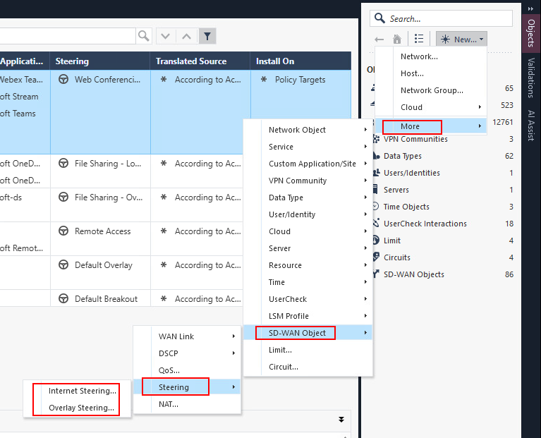

Create an Internet Steering object named `lab-internet-steering`:

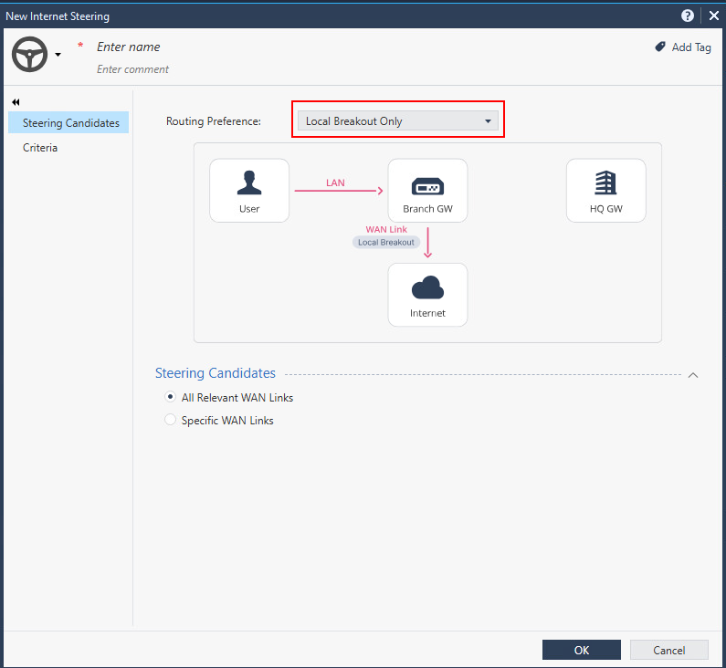

- In **Routing Preference**, switch between **Local Breakout Only**, **Backhaul Only**, and **Prioritize Local Breakout** and watch the diagram change.
- In **Steering Candidates**, compare **All Relevant WAN Links** with **Specific WAN Links**.
- In **Criteria**, review the latency, jitter, and packet-loss thresholds that make a link qualify or move traffic away from it.
- Click **OK**.

Now create an Overlay Steering object named `lab-overlay-steering`, compare the two dialogs, and click **OK**. You don't use these objects later; delete them before you publish.

> **Question:** What is the main difference between Internet Steering and Overlay Steering?
>
> **Answer:** Internet Steering handles traffic that goes to the Internet (local breakout, backhaul to HQ, or both). Overlay Steering handles traffic between SD-WAN gateways and picks which WAN link pairs carry the tunnels.

More detail: [Internet and Overlay Steering Use Cases](https://sc1.checkpoint.com/documents/SD-WAN-with-Smart1/Content/Topics-SD-WAN-Smart-1/9_2_Detailed_Internet_and_Overlay_Steering_Use_Cases.htm)

---

## Part 3: Create the SD-WAN Policy

Time: 15 minutes

The SD-WAN Policy is a shared policy. It **isn't** tied to one policy package.

- Go to **Security Policies**
- Under **Shared Policies**, click **SD-WAN Policy**
- Click **Create Policy**
- Keep all use cases selected, including **Enable SD-WAN Overlay Traffic**
- Click **Create Policy**
<div align="center">

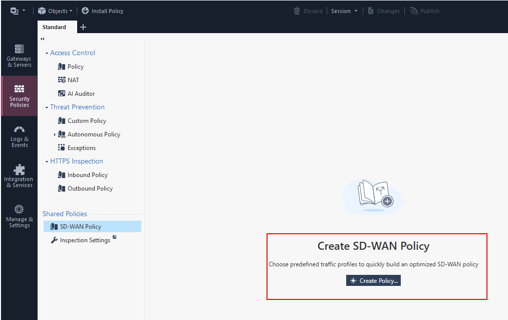

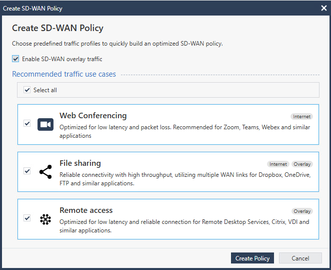

</div>

### Read the default rules

With all use cases selected, you get:

- Local Breakout rules for Web Conferencing and File Sharing
- Overlay rules for File Sharing and Remote Access
- A default Overlay catch-all rule
- A default Breakout catch-all rule

Look at the columns: **Name**, **Source**, **Destination**, **Services & Applications**, **Steering**, **Translated Source**, **Install On**. Right-click the column header to reveal **QoS** and **Comment**.

<div align="center">

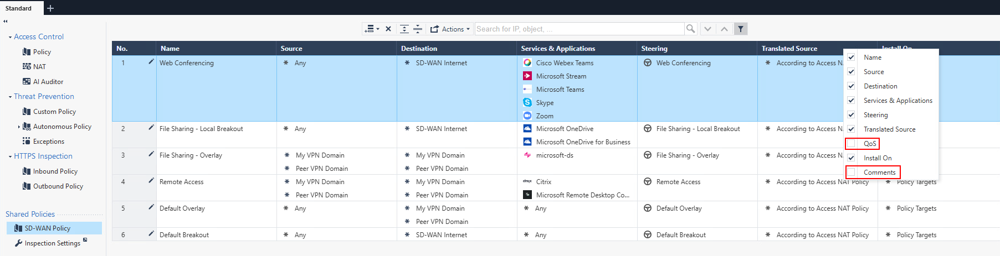

</div>

Answer these questions:

- Which Steering object does the **Web Conferencing rule** use, and which WAN links does it list as candidates?
- Which Steering object does the **default Overlay** rule use?
- In the Overlay rules, which objects fill **Source** and **Destination**?

> **What you should see.** Internet rules use the **SD-WAN Internet** object as the destination. Overlay rules use **My VPN Domain** and **Peer VPN Domain**. These topology-derived objects follow your VPN domains and routing, so you don't maintain IP ranges by hand. They work only inside the SD-WAN Policy.

Open the Steering objects and review the settings:

| Setting | What it controls |
|---|---|
| **Steering candidates** | Which WAN links the rule may use (all relevant links, or specific ones) |
| **Criteria and thresholds** | Latency, jitter, and packet loss limits |
| **WAN link utilization** | For example, aggregation across all links that meet the thresholds |
| **Quality check** | How often the gateway tests each link |

Rule order matters: put specific rules above general ones.

---

## Part 4: Configure VPN and Access Control for the overlay

Time: 25 minutes

The overlay needs the following settings in the VPN community and the Access Control policy.

### 4.1 Set the Star community for the overlay

- Go to **Security Policies > Access Control > VPN Communities**
- Open the Star community
- On the **Gateways** page, confirm the center and satellites
- Open the routing mode and select **To center only** or **To center and to other satellites through center**
- On the **MEP** page, clear **Enable MEP**
- Go to **Tunnels > Monitoring** and clear **Set Permanent Tunnels**
- Go to **Access Control Policy > Properties** and select **Disable NAT inside the VPN Community**
- Click **OK**

> Avoid NAT between the internal networks behind VPN peers. Disabling NAT inside the community is the simplest way.

> **Don't do this:** on a gateway object, don't select **Exclude gateway external IP addresses from the VPN Domain**. It interrupts overlay probing.


### 4.2 Review the overlay probing rule

Overlay probing sends Internet Control Message Protocol (ICMP) echo requests between the peers. The probes must be allowed and encrypted.

- Open both Access Control policy packages, `SD-WAN-DC` and `SD-WAN-Branch`. Both contain the same probing rules.
<div align="center">

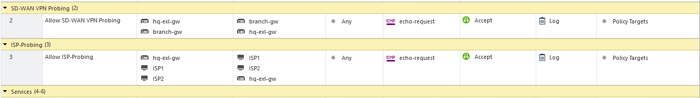

</div>

> If **Global Properties > Firewall > Accept ICMP requests** is enabled, the implied rule can match your probes and send them in clear text. Probes must be encrypted. Set the implied rule to **Last** or **Before Last** and keep the explicit rule.

---

<details>
<summary><strong>Observability over Skyline</strong></summary>

> :memo: On the `hq-linux` host, Skyline with a Check Point prepared Grafana dashboard is waiting for gateway data :+1:

To allow communication to Prometheus:

- Add rule 2 to the `SD-WAN-DC` policy package, to allow traffic to Skyline (192.168.30.40, port 8080):

| source | destination | port |
|---|---|---|
| `any` | `192.168.30.40` | http_and_https_proxy |

> **:memo:** In this lab, the Prometheus default port 9090 is mapped to 8080.

On each gateway that should send telemetry data to Prometheus, follow these steps:

- Modify the file, or create it if it doesn't exist:

```bash
vi /var/tmp/payload.json
```
- Add this content:

```json
 {
    "enabled": true,
    "export-targets": {"add": [
        {
            "enabled": true,
            "type": "prometheus-remote-write",
            "url": "http://192.168.30.40:8080/api/v1/write"
        }
    ]}
} 

```
- Run this command to apply the configuration:

```
sklnctl export --set "$(cat /var/tmp/payload.json)"
```

Open http://192.168.30.40:3000 and open the "SD-WAN Observability Dashboard".

</details>

## Part 5: Install and validate

Time: 30 minutes

### 5.1 Install

- Click **Publish**
- Click **Install Policy**
- Select the Access Control policy and both gateways: hq-exl and branch-gw
- Click **Install**

> The SD-WAN Policy installs with the Access Control policy. Watch the task. If it fails, fix the Access Control error first.

- Browse to an Internet site (https://bbc.com)
- Browse to `http://172.30.1.60` (the web server at the branch)

- In **Logs & Events**, search for `dst:172.30.1.60` and confirm you see an Encrypt log
<div align="center">

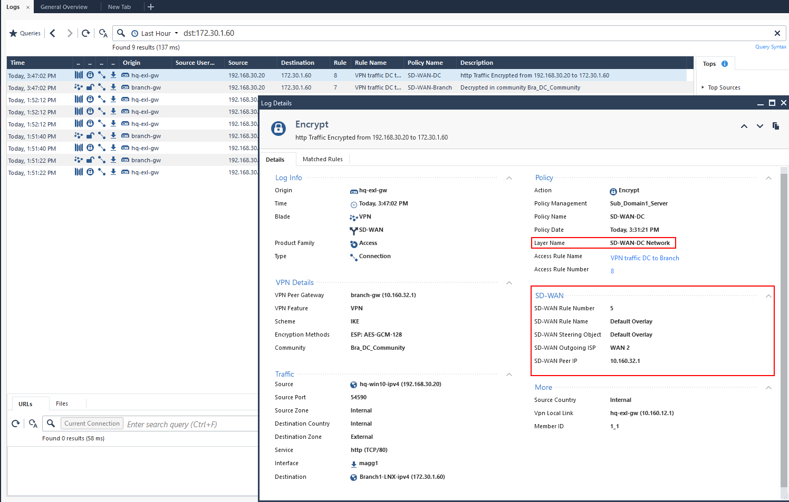

</div>

You see a couple of new records that give you more insight into the objects that the lab policy matched.

Answer these questions:

- Which Steering object was used when you accessed 172.30.1.60?
- Which Steering object was used when you accessed bbc.com?
- What is the name of the policy layer?
- Over which interface did `hq-exl-gw` forward the traffic?

Now open the log entry from branch-gw.

Answer these questions:

- Why don't you see SD-WAN log information here?


<details>
<summary><strong>Check the SD-WAN information in Expert mode:</strong></summary>

On hq-exl, log in to Expert mode and run:

```bash
sdwan show --status
sdwan show --isps
sdwan show --peers
fw sdwan stat
```

CPView shows live telemetry data. For SD-WAN, go to **Advanced > SDWAN**. See [Read probing results in CPView](#52-read-probing-results-in-cpview)


</details>

> **Expected result:** the status shows the SD-WAN Policy installed. `isps` lists your SD-WAN interfaces with their circuit. `peers` lists branch-gw with its interfaces and circuit. If the peer doesn't appear, check the community membership, the interface names, and the install on both sides.

### 5.2 Read probing results in CPView

- On hq-exl, run `cpview`
- Go to **Advanced > SDWAN > Probing-IPv4**
- Read **Local Breakout Probing Results**
- Read **Overlay Probing Results**
<div align="center">

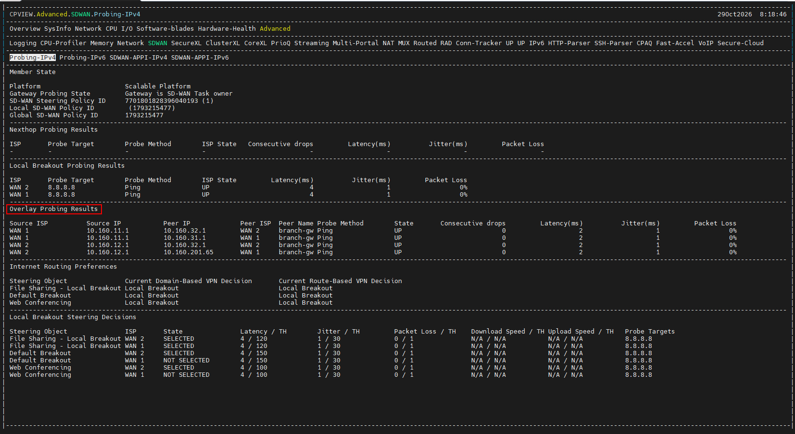

</div>

> **Expected result:** each Internet link shows a Local Breakout probe in state UP. Overlay Probing Results lists a state per tunnel, with latency, jitter, and packet loss. With two public interfaces on each side and one shared circuit, each gateway shows four tunnels.

### 5.3 Check the tunnels

In Expert mode:

```bash
vpn tu tlist
```

Each tunnel shows `From:` and `To:` fields with the SD-WAN interface addresses on both sides. That's how you know SD-WAN built a tunnel per interface pair, and not a classic Link Selection tunnel.

<div align="center">

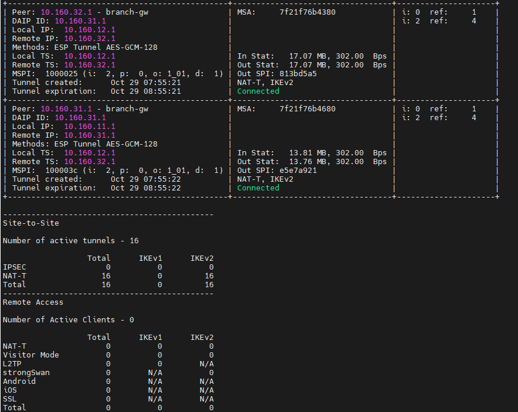

</div>

### 5.4 Test the traffic

On `hq-client`, open a private browser window:

- Browse to an Internet site (Local Breakout)
- Browse to `http://172.30.1.60` (Overlay)
- Press `Ctrl+F5` a few times to create new connections

On `Branch-client`, open a private browser window:
- Browse to `http://bbc.com` (Local Breakout)

In SmartConsole, open **Logs & Events**:

- Search for `dst:bbc.com` and open the **session** log
- Open the **Connections** tab and open a connection log from the firewall blade

> **Expected result:** the SD-WAN section shows the Local Breakout rule and the ISP used.
<div align="center">

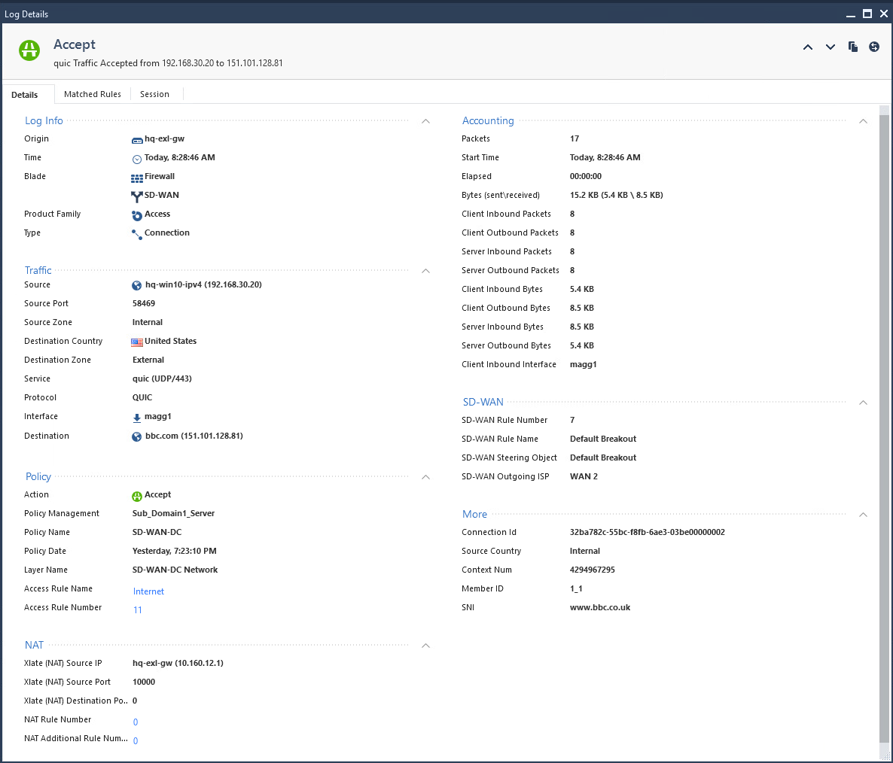

</div>

## Part 6: Backhaul Verification

Time: 20 minutes

Send the branch's Internet traffic through headquarters over the overlay.

> **Prerequisites.** Backhaul needs the headquarters gateway to act as the center of the Star community, and the VPN routing option "To center, or through the center to other satellites, to Internet and other VPN targets". 

The following rule is prepared in the lab as an example of how to steer client traffic to a specific site through the backhaul.

<div align="center">

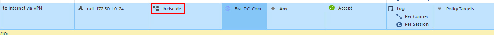

</div>

- Open the branch network object, go to **NAT**, select **Add automatic address translation rules**, then **Hide behind gateway**, and set **Install On** to **All**  
  
<div align="center">

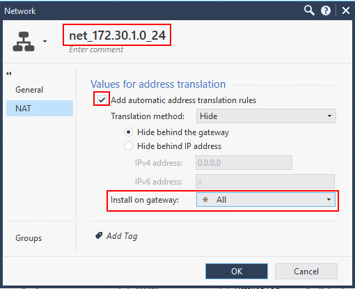

</div>


- Keep **Disable NAT** selected in the community, so the traffic translates only when it leaves the center

- Publish and install on both gateways
- Add a rule above the Backhaul rule, with the branch gateway object as source and Local Breakout Only steering, if you want the gateway's own Internet traffic to leave locally

On Branch-client, open a private browser window:
- Browse to `http://heise.de` (Backhaul)
- Wait for the page to load completely
- Verify that the traffic is being backhauled through the headquarters gateway.
- Search for the logs that are related to `dst:heise.de` and open the latest **Encrypt** log
- Find the **SD-WAN** section in the log card

> **Expected result:** the log shows the SD-WAN rule that matched, the Steering object, and which interface carried the encrypted traffic.

- Note which rule matched the traffic and which interface carried it
- Open the steering object that matched the rule.

Create a new steering object that matches the traffic pattern and specifies the preferred interface for the backhaul traffic.

Apply the changes and verify that the new steering object is used for subsequent traffic.   

---

## Part 7: Change Tunnel Peering by using circuits

Time: 30 minutes

Now you turn the second link into a private line. In the lab, a router between the gateways simulates MPLS (Multiprotocol Label Switching). The gateways now see a private next hop on `eth3`.

SD-WAN builds tunnels only between interfaces on the same circuit. Giving the private line its own circuit changes the tunnel count. That's the lesson.

### 7.1 Create the MPLS WAN Link and circuit

<details>
<summary><strong>Creating custom WAN Link and circuit</strong></summary>

- In SmartConsole, create a new **Circuit** for the private line. 
<div align="center">

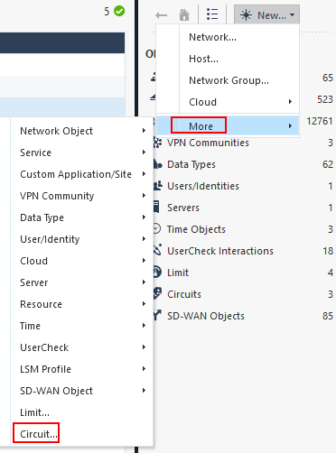

</div>

<div align="center">

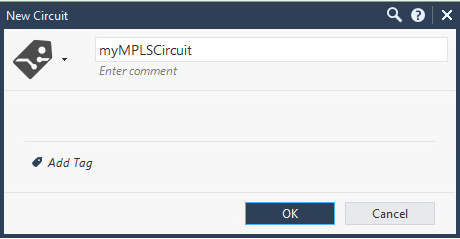

</div>

- Create a WAN Link named `MPLS` and set its type to **Private**
<div align="center">

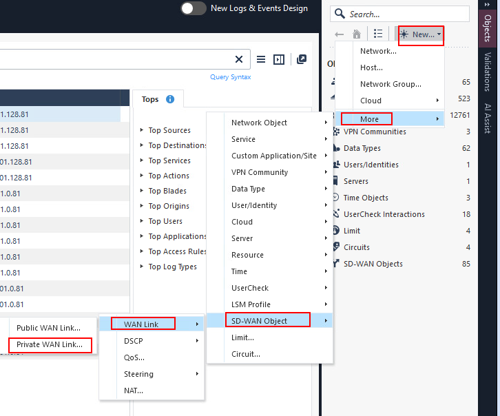

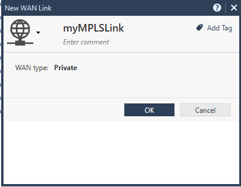

</div>

</details>


### 7.2 Move `eth3` to the MPLS WAN Link

On hq-exl:

- Open the gateway object and go to **Network Management**
- Edit `eth3` and open its **SD-WAN** tab
- Map the interface to WAN Link `MPLS`
- Go to interface's **Network Access** and assign the interface to `private circuit`

On branch-gw:

- Open the gateway object and go to **Network Management**
- Edit `eth3` and open its **SD-WAN** tab
- Map the interface to WAN Link `MPLS`
- Go to interface's **Network Access** and assign the interface to `private circuit`
  
**Publish** and **Install Policy** on both gateways


### 7.3 Observe

- In CPView on either gateway, open **Advanced > SDWAN > Probing-IPv4 > Overlay Probing Results**
<div align="center">

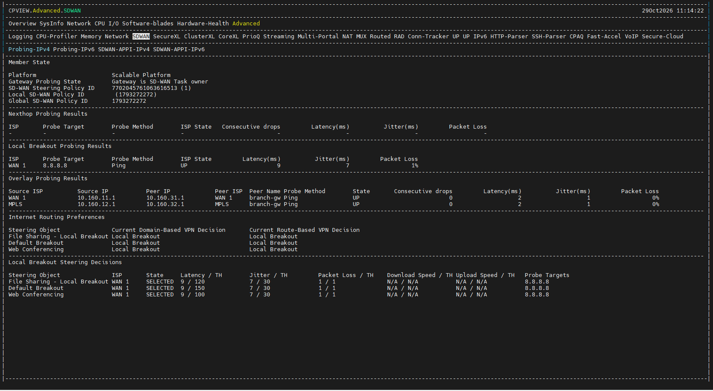

</div>

 
- Run `sdwan show --isps` and compare the circuits of `eth3` and `eth2`

- On hq-client, test the Internet site and `http://bbc.com` again
- On hq-client, test the Internet site and `http://172.30.1.60` again
- On Branch1-client, test the Internet site and `http://bbc.com` 
- On Branch1-client, test the Internet site and `http://192.168.30.40` 

> **Expected result:** all connections should work and generate logs. Overlay Probing Results now shows 2 tunnels instead of 4.

- In SmartConsole, open the Encrypt log for the web server and note which interface carried it

---

## Part 8: Fail over

Time: 15 minutes

Open the VYOS1 VM and shut down the interface:

```
configure 
set interface ethernet eth1 disable
commit

```

What can you observe in CPView on hq-exl?
Check the current status in CPView on branch-gw and note the status of the tunnels.

- On hq-client, reload `http://bbc.com` and `http://172.30.1.60` and a few times
- In SmartConsole, open the latest log for `dst:bbc.com` and `dst:172.30.1.60`

> **Expected result:** the traffic now uses the private MPLS connection. The VPN peer is the branch-gw `eth3` address 10.160.32.1.

- On branch-gw, open CPView and look at **Overlay Probing Results**

> **Expected result:** the tunnel over the public link shows DOWN.

- On hq-exl, run `show route` and note which default route is active

> **Think about it:** user traffic failed over because of the SD-WAN Policy. The gateway's own traffic failed over because of the Gaia route with `ping on`. You need both.


Go back to VYOS1 and enable the interface again:

```
delete interface ethernet eth1 disable
commit
```
- Confirm the public tunnel returns to UP in CPView

---

### Exercise: check VPN peer status

- On hq-exl, in Expert mode, list all tunnels:

```bash
vpn tu tlist
```

- Check one probing connection (replace the addresses with your interface addresses):

```bash
vpn tu conn <local-interface-ip> - <peer-interface-ip> - 1
```

> The minus sign is a wildcard. A healthy connection shows `Encrypted`, plus `From:` and `To:` fields and a valid `Out SPI`.

### If you need more

- Policy install problems: `sdwan install -d $FWDIR/state/__tmp/SDWAN/`, then read `$FWDIR/log/sdwan.elg` and `$FWDIR/log/sdwan_steering.elg`
- Missing peer in CPView: check interface names in all three places, community membership, and that both gateways run the same management method

---

## Optional challenges
### Check that Threat Prevention still sees overlay traffic

- Open the console of the test host (Hacker and JMeter in the topology diagram)
- Start an automated web scan against `http://172.30.1.60`
- In SmartConsole, search for `dst:172.30.1.60 AND blade:IPS`

> **Expected result:** IPS logs appear. SD-WAN steers the traffic. It doesn't skip inspection.

---

## Cheat sheet

| Task | Command |
|---|---|
| SD-WAN status (Clish) | `show sdwan status` |
| SD-WAN interfaces and circuits | `show sdwan isps` or `sdwan show --isps` |
| SD-WAN peers | `show sdwan peers` or `sdwan show --peers` |
| Installed SD-WAN Policy date | `fw sdwan stat` |
| Probing results | `cpview` > **Advanced** > **SDWAN** > **Probing-IPv4** |
| VPN tunnels | `vpn tu tlist` |
| One connection's tunnel | `vpn tu conn <src> <sport> <dst> <dport> <proto>` |
| Packet path | `fw monitor -F "<src>,0,<dst>,0,0" -F "<dst>,0,<src>,0,0"` |
| Drops | `fw ctl zdebug + drop` |
| Steering log | `$FWDIR/log/sdwan_steering.elg` |


---

## Reference

- [1. Introduction](https://sc1.checkpoint.com/documents/SD-WAN-with-Smart1/Content/Topics-SD-WAN-Smart-1/1_Introduction.htm)
- [2. Requirements, Licensing, and Supported Deployments](https://sc1.checkpoint.com/documents/SD-WAN-with-Smart1/Content/Topics-SD-WAN-Smart-1/2_Requirements.htm)
- [4. Prepare Security Gateway Networking](https://sc1.checkpoint.com/documents/SD-WAN-with-Smart1/Content/Topics-SD-WAN-Smart-1/4_Prepare_Security_Gateway_Networking.htm)
- [8. Configure the SD-WAN Policy](https://sc1.checkpoint.com/documents/SD-WAN-with-Smart1/Content/Topics-SD-WAN-Smart-1/8_Configure_SDWAN_Policy.htm)
- [9.1 Configuring VPN and Access Control Requirements for Overlay and Backhaul](https://sc1.checkpoint.com/documents/SD-WAN-with-Smart1/Content/Topics-SD-WAN-Smart-1/9_1_Configuring_VPN_and_Access_Control_for_Overlay_and_Backhaul.htm)
- [9.4 Best Practices](https://sc1.checkpoint.com/documents/SD-WAN-with-Smart1/Content/Topics-SD-WAN-Smart-1/9_4_Best_Practices.htm)
- [13. Troubleshooting](https://sc1.checkpoint.com/documents/SD-WAN-with-Smart1/Content/Topics-SD-WAN-Smart-1/13_Troubleshooting.htm)


