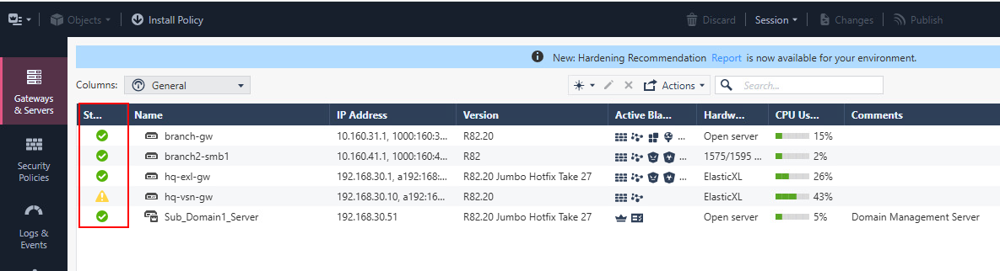
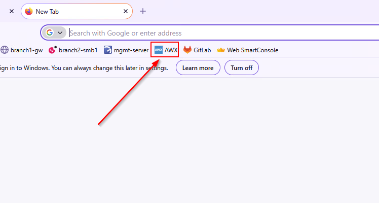
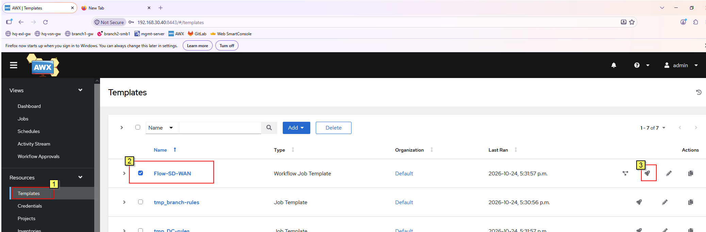
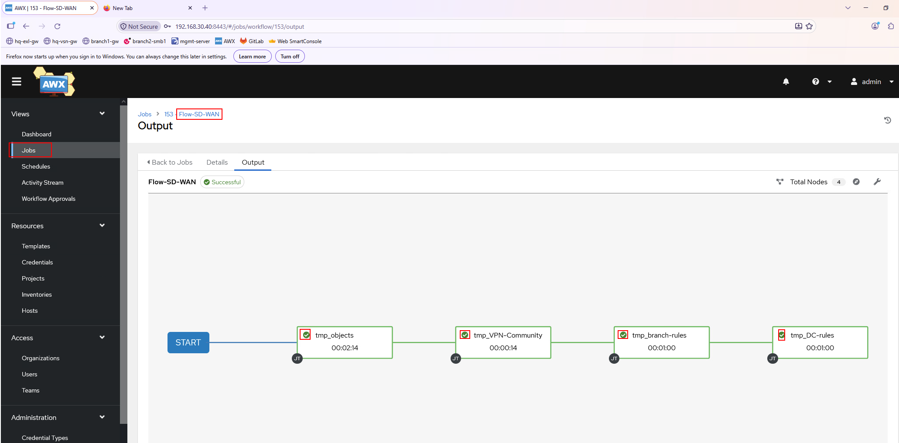
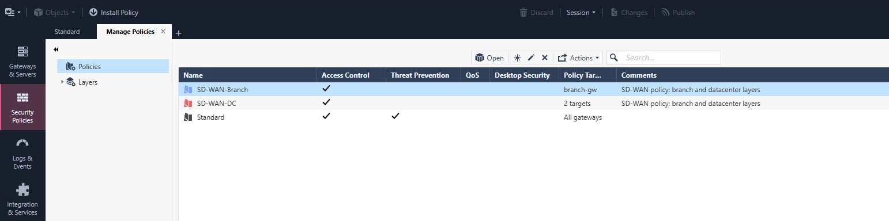
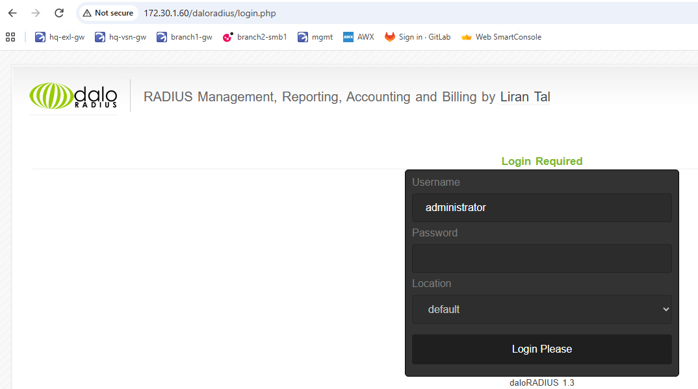
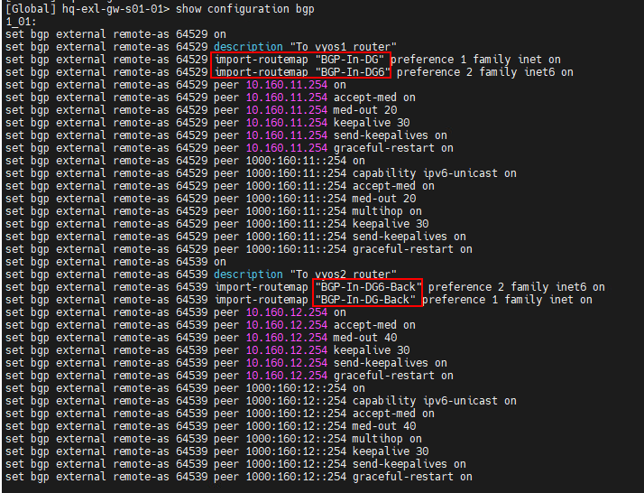
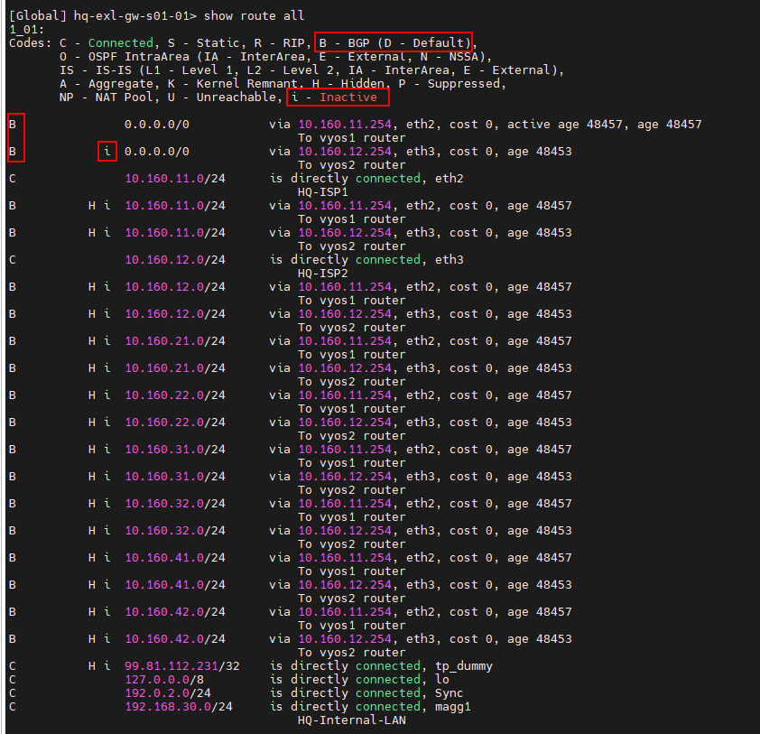
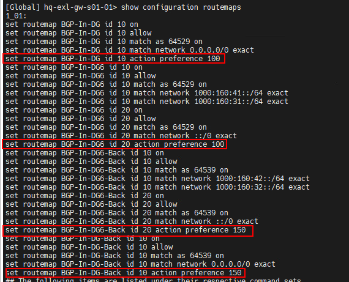

# Check Point SD-WAN On Prem Lab Guide

## Contents

- [What you lern here](#what-you-will-learn)
- [How SD-WAN works in 60 sec](#how-sd-wan-works-in-60-seconds)
- [Before you start](#before-you-start)
- [Lab Access](#lab-access)
- [Lab setup](#lab-setup)
- [Part 0: Get familiar with the environment](#part-0-get-familiar-with-the-environment)
- [Part 1: Prepare gateway networking](#part-1-prepare-gateway-networking)
- [Part 2: Enable SD-WAN on hq-exl and branch-gw](#part-2-enable-sd-wan-on-hq-exl-and-branch-gw)
- [Part 3: Create the SD-WAN Policy](#part-3-create-the-sd-wan-policy)
- [Part 4: Configure VPN and Access Control for the overlay](#part-4-configure-vpn-and-access-control-for-the-overlay)
- [Part 5: Install and validate](#part-5-install-and-validate)
- [Part 6: Add an MPLS line](#part-6-add-an-mpls-line)
- [Part 7: Fail over](#part-7-fail-over)
- [Part 8: Troubleshoot](#part-8-troubleshoot)
- [Optional challenges](#optional-challenges)


# Check Point SD-WAN with Smart-1 Unified Management: Hands-On Lab Guide

In this Virtual Lab environment you get access to two WAN interfacing lines. One can be used to simulated MPLS line. 
**Spoiler Alarm**: One place to manage it all: SmartConsole.

In this lab, you steer traffic across several WAN links with Check Point software-defined wide area network (SD-WAN). You run the whole deployment from SmartConsole on an on-premises Management Server. No Portal is involved.

| | |
|---|---|
| **Management model** | Smart-1 Unified Management (SD-WAN objects, gateway settings, and SD-WAN Policy live in SmartConsole) |
| **Release** | R82.20 |
| **Suggested time** | Three hours, including one break. Adjust after your first pilot run |
| **Level** | Familiar with SmartConsole, Gaia, and Site-to-Site VPN |
| **Admin guide (EA)** | [Check Point SD-WAN - Smart-1 Unified Management R82.20 Administration Guide](https://sc1.checkpoint.com/documents/SD-WAN-with-Smart1/Content/Topics-SD-WAN-Smart-1/1_Introduction.htm) |

## What you will learn

- Enable SD-WAN objects on an on-premises Management Server
- Prepare gateway routing so local and overlay traffic fail over cleanly
- Enable the SD-WAN Software Blade and map interfaces to WAN links
- Create the SD-WAN Policy and read its default rules
- Build the VPN and Access Control rules that the overlay needs
- Prove steering works with logs, CPView, and the SD-WAN command line
- Turn one public link into a private MPLS line and watch the tunnel count change
- Break the overlay on purpose, then fix it

## How SD-WAN works in 60 seconds

SD-WAN picks the best WAN link for each connection. It measures link quality (latency, jitter, and packet loss) and applies your SD-WAN Policy. You don't need dynamic routing for this.

Three traffic types matter in this lab:

| Use case | What it does | Lab example |
|---|---|---|
| **Local Breakout** | Sends Internet traffic out through the best local ISP | hq-client browsing to the Internet |
| **Overlay** | Picks the best VPN tunnel between SD-WAN peers | hq-client reaching the web server at the branch |
| **Backhaul** | Sends branch Internet traffic through the headquarters over the VPN | Optional challenge at the end |

The management path is simple: the Management Server installs the SD-WAN Policy with the Access Control policy. The SD-WAN process on each gateway then enforces it.

---

## Before you start

### Lab access

Your trainer gives you the login details for every lab machine through the lab portal. Keep them there. Don't type them into notes, scripts, or browser password stores, and don't paste them into this guide.

### Lab setup 

| Component | Gaia version used in this LAB|
|---|---|
| Management Server | R82.20 |
| Security Gateway or ClusterXL | R82.20 |
| Spark Firewall (if your topology includes one) | R82.00.11 |

> **Important Note for Policy Packages Installation**: The SD-WAN Policy is a shared Policy and gets installed on Gateways as part of the Access Control policy installation. If a new or modified Access Control install fails on any gateway in the run, the SD-WAN Policy is also not enforced. 

### Lab values

during the lab you will need additional information which is based on topology of this Lab. 
- [Lab network topology](https://checkpointsw-devsec.github.io/DemoLab-Guides/Notes/index.html)

Hover to trace a connection, and click a device for its addresses.
<div align="center">

| Item | Value |
|---|---|
| hq-exl, ISP1 interface | `eth3`, 10.160.20.10, <br>next hop 10.160.20.254 |
| hq-exl, ISP2 interface | `eth1`, <br>next hop 10.160.21.254 |
| hq-exl, MPLS next hop (Part 7) | 10.160.21.254 |
| branch-gw, ISP1 interface | `eth2`, 10.160.30.30, <br>next hop 10.160.30.254 |
| branch-gw, ISP2 interface | `eth1`, 10.160.31.30, <br>next hop 10.160.31.254 |
| branch-gw, MPLS next hop (Part 7) | 10.160.31.254 |
| HQ VPN domain | `net_192.168.30.0_24` |
| Branch VPN domain | `net_172.30.1.0_24` |
| Web server (branch-linux) | 10.160.40.100 |


</div>

---

## Part 0: Get familiar with the environment

Time: 15 minutes

in this Part you get more friendly to the lab environment and deploy the Policy Packages for the lab.

1. Open SmartConsole from the management client
2. Open **Gateways & Servers** and confirm that hq-exl and branch-gw show a healthy status


3. Open **Security Policies** and review the Access Control rule base on both gateways' policy packages

> The lab cleanup rule accepts all traffic. The data center and branch office policy packages become available after you run the prepared AWX workflow.

- **Policy Package**

to get the policy packages for this lab please:

open firefox browser and click on prepared AWX (ansible Works) bookmark



for credentials plese see [Lab network topology](https://checkpointsw-devsec.github.io/DemoLab-Guides/Notes/index.html)


go to the Templates and launch "Flow-SD-WAN"



ansible scripts are synced from following public github repository

<a href="https://github.com/checkpointsw-devsec/DemoLab-Guides/tree/main/Lab-Code" target="_blank" rel="noopener noreferrer">Open github-URL</a>

This flow uses ansible scripts that are stored on GitLab in this Lab. 

flow output shows the different playbooks that are used in this flow. tmp is used as abbriviation for Template
- tmp_objects (definition of the Objects that are used by Community or Policy packages)
- tmp_VPN-Community (definition of the VPN Community Object)
- tmp_branch-rules (definition of the rules for branch-Office Policy Package)
- tmp_DC-Rules(definition of the rules for Data Center Policy Package)

  

after a successful run of "Flow-SD-WAN", objects that are used in this lab get available in Smart Console.

Please check Policy packages:


for more Information about AWX or GitLab you can see: [GitLab](https://github.com/checkpointsw-devsec/DemoLab-Guides/blob/main/PlayBooks/Shared-Books/GitLab.md) [AWX](https://github.com/checkpointsw-devsec/DemoLab-Guides/blob/main/PlayBooks/Shared-Books/AWX.md)

4. Open **VPN Communities** named Bra_DC_Community and Check / set these settings in the Star community:

- On the **Gateways** page, center has to be **hq-exl-gw**
- satellite gateway:  **branch-gw**
- routing mode: Domain Based! the lab uses "To center and to other satellites through center"
- On **Access Control Policy > Properties**, note whether NAT is disabled inside the community
- On **Encryption**, note the IKE version

5. Check the VPN domains and Link Selection:

- Open hq-exl-gw: set VPN domain to `net_192.168.30.0_24`
- Open branch-gw: set VPN domain is `net_172.30.1.0_24`
- In each gateway, open **IPSec VPN > Link Selection** and note the primary interface

+ ++++++++++++++++++++++++++++++++++++++++++++++++++++++++++++++++++++++++++++
+ ++++++++++++++++++++++++++++++++++++++++++++++++++++++++++++++++++++++++++++
+ ++++++++++++++++++++++++++++++++++++++++++++++++++++++++++++++++++++++++++++
> **Why Link Selection matters.** i have to define something good here .
+ ++++++++++++++++++++++++++++++++++++++++++++++++++++++++++++++++++++++++++++
+ ++++++++++++++++++++++++++++++++++++++++++++++++++++++++++++++++++++++++++++
+ ++++++++++++++++++++++++++++++++++++++++++++++++++++++++++++++++++++++++++++

Install **Standard** Policy Package and check Traffic from hq-client:

- Browse to an Internet site (https://bbc.com)
- Browse to `http://172.30.1.60` (the web server at the branch)



- In **Logs & Events**, search for `dst:172.30.1.60` and confirm you see an Encrypt log

> **Expected result:** both sites load, and the Encrypt log shows the VPN path. 
> you should observe at least two log entries to 172.30.1.60

You have a working VPN but no SD-WAN yet.

---

<details>
<summary><strong>During EA Phase</strong></summary>

## EA Part 0: Enable SD-WAN Blade on the Gateway Objects

**This section has been prepaded since it will be fulfilled in the GA!**

> SD-WAN configuration capabilities in EA Phase stay hidden in SmartConsole until you switch them on at the Management Server. Do this before anything else.

- Open an SSH session to the Management Server and log in to Expert mode
- Check the Web SmartConsole package version:

```bash
autoupdatercli show web_console -f json | jq -r '[.. | objects | select((."package-installed"|tostring)=="true") | ."package-version"] | "Web SmartConsole version is: \(max)"'
```

- If the version is lower than 176, update the package:

```bash
autoupdatercli update_component web_console
```

- Check the current file so you don't add duplicate entries:

```bash
cat $FWDIR/conf/mwc.env
```

- Add the two parameters, but only if they aren't already in the file:

```bash
echo FF_SD_WAN=1 >> $FWDIR/conf/mwc.env
echo CF_SD_WAN=1 >> $FWDIR/conf/mwc.env
```

- Restart the Web SmartConsole component:

```bash
wsc restart
```

> Restarting can disconnect active Web SmartConsole sessions. 

- Reconnect with SmartConsole
- Go to **Security Policies** and look in the **Shared Policies** section

> **Expected result:** the **SD-WAN Policy** entry appears under Shared Policies.

</details>

---

## Part 1: Prepare gateway networking

Time: 20 minutes

SD-WAN builds on the gateway's own routing table. Set that foundation first.

Gateway-originated traffic follows the Gaia routing table, not SD-WAN rules. SD-WAN never changes that table. If ISP1 fails and your default route still points at ISP1, the gateway itself loses its connection even while user traffic fails over.

So each ISP gets its own default route with its own priority. A lower number wins. No priority means priority 0, the highest preference.

**Licensing.** Each SD-WAN gateway needs an SD-WAN subscription associated in the User Center and attached to the gateway. Your trainer has already attached the lab licenses. After Part 3, SD-WAN should appear in the list of enabled Software Blades on each gateway.

### hq-exl
in this step you will check bgp peers and existing routes.

- Open the Gaia Web portal for hq-exl, or connect over SSH and open Gaia Clish (gclish)
- Review the current routes:

```
show configuration bgp 
show configuration routemaps
show route all
```







in current setup routemap define the preference.
all routes are advertised by the "ISP" routers. here named as VYOS1 and VYOS2


3. Add only what is missing:

```clish
set static-route default ping on
save config
```

> If hq-exl runs as a cluster in your topology, repeat this on every cluster member.

### branch-gw

1. Connect to branch-gw and open Gaia Clish
2. Add only what is missing:

```clish
set static-route default ping on
save config
```

<details>
<summary><strong>Advanced: monitor a real target with IP Reachability Detection</strong></summary>

`ping on` only watches the next hop. A better design watches a target beyond the ISP. Pick one target per ISP, route each target through its own ISP, and attach it to that ISP's default route. Don't attach a target to the last-resort route.

```clish
set ip-reachability-detection ping address 10.160.41.1 enable-ping on
set ip-reachability-detection ping address 10.160.42.1 enable-ping on
set static-route 10.160.41.1/32 nexthop gateway address 10.160.11.254 on
set static-route 10.160.42.1/32 nexthop gateway address 10.160.12.254 on
set static-route default nexthop gateway address 10.160.11.254 monitored-ip 10.160.41.1 on
set static-route default nexthop gateway address 10.160.12.254 priority 1 on
save config
```

target address are the branch 2 WAN connections of spark gateway. they are used here as an example for targets that your lab ISPs actually route.

</details>

> **Expected result:** `show route` lists two default routes with different priorities, and both next hops answer.

---

## Part 2: Enable SD-WAN on hq-exl and branch-gw

Time: 30 minutes

### 3.1 Create the SD-WAN objects

You need two kinds of objects:

| Object | What it is |
|---|---|
| **Circuit** | A WAN domain. Overlay tunnels form only between interfaces that share a circuit |
| **WAN Link** | An SD-WAN object mapped to a gateway interface. Public (Internet) or private (MPLS) |

- In SmartConsole, open the SD-WAN Gateway objects. enable SD-WAN blade and 
- Create a WAN Link named `ISP1` (public)
- Create a WAN Link named `ISP2` (public)
- Use the default public circuit for both for now

> Both Internet links share one circuit. That is why every interface pair forms a tunnel. You change this in Part 7.

### 3.2 Enable the blade and the interfaces on hq-exl

- Go to **Gateways & Servers** and open hq-exl
- Select the **SD-WAN** Software Blade
- Open **Network Management** and confirm that `eth3` and `eth1` use the topology **External**
- Compare the interface names with the names in Gaia

> Interface names must match in three places: the Gaia OS, the gateway object's Network Management page, and the installed SD-WAN policy. A mismatch is the most common reason an expected tunnel is missing. In a cluster, the Cluster Virtual Interface names must match the member interface names too.

- Edit `eth3`, then open its **SD-WAN** tab
- Enable SD-WAN on the interface and map it to WAN Link `ISP1`
- Set the next hop mode to **Custom** and enter 10.160.11.254
- Edit `eth1`, then open its **SD-WAN** tab
- Enable SD-WAN and map it to WAN Link `ISP2`
- Set the next hop mode to **Custom** and enter 10.160.12.254
- Leave **Symmetric Return** at its default
- Click **OK**

### 3.3 Repeat on branch-gw

| Interface | WAN Link | Next hop |
|---|---|---|
| `eth2` | `ISP1` | 10.160.30.1 |
| `eth1` | `ISP2` | 10.160.31.1 |

- Open branch-gw and select the **SD-WAN** Software Blade
- Enable SD-WAN on `eth2` and `eth1` with the values above
- Click **OK**
- **Publish** the session

> **Try it later:** Automatic Next Hop reads the next hop from the Gaia routing table, which is another reason Part 2 matters. If it can't find a valid route, set the next hop to Custom. If Auto fails and a WAN Link is the only source in a steering object, policy installation can fail.

> **Expected result:** both gateways show SD-WAN enabled, and the session is published.

---

## Part 3: Create the SD-WAN Policy

Time: 15 minutes

The SD-WAN Policy is a shared policy. It isn't tied to one policy package.

- Go to **Security Policies**
- Under **Shared Policies**, click **SD-WAN Policy**
- Click **Create Policy**
- Keep all use cases selected, including **Enable SD-WAN Overlay Traffic**
- Click **Create Policy**

### Read the default rules

With all use cases selected, you get:

- Local Breakout rules for Web Conferencing and File Sharing
- Overlay rules for File Sharing and Remote Access
- A default Overlay catch-all rule
- A default Breakout catch-all rule

Look at the columns: **Name**, **Source**, **Destination**, **Services & Applications**, **Steering**, **Translated Source**, **Install On**. Right-click the column header to reveal **QoS** and **Comment**.

Answer these questions:

- Which Steering object does the Web Conferencing rule use, and which WAN links does it list as candidates?
- Which Steering object does the default Overlay rule use?
- In the Overlay rules, which objects fill **Source** and **Destination**?

> **What you should see.** Internet rules use the **SD-WAN Internet** object as the destination. Overlay rules use **My VPN Domain** and **Peer VPN Domain**. These topology-derived objects follow your VPN domains and routing, so you don't maintain IP ranges by hand. They work only inside the SD-WAN Policy.

Open the Steering objects and review the settings:

| Setting | What it controls |
|---|---|
| **Steering candidates** | Which WAN links the rule may use (all relevant links, or specific ones) |
| **Criteria and thresholds** | Latency, jitter, and packet loss limits |
| **WAN link utilization** | For example, aggregation across all links that meet the thresholds |
| **Quality check** | How often the gateway tests each link |

Rule order matters: put specific rules above general ones.

---

## Part 4: Configure VPN and Access Control for the overlay

Time: 25 minutes

The overlay needs four things in the Access Control policy and the VPN community.

### 5.1 Set the Star community for the overlay

- Go to **Security Policies > Access Control > VPN Communities**
- Open the Star community
- On the **Gateways** page, confirm the center and satellites
- Open the routing mode and select **To center only** or **To center and to other satellites through center**
- On the **MEP** page, clear **Enable MEP**
- Go to **Tunnels > Monitoring** and clear **Set Permanent Tunnels**
- Go to **Access Control Policy > Properties** and select **Disable NAT inside the VPN Community**
- Click **OK**

> Avoid NAT between the internal networks behind VPN peers. Disabling NAT inside the community is the simplest way.

> **Don't do this:** on a gateway object, don't select **Exclude gateway external IP addresses from the VPN Domain**. It interrupts overlay probing.

### 5.2 Add the overlay probing rule

Overlay probing sends Internet Control Message Protocol (ICMP) echo requests between the peers. The probes must be allowed and encrypted.

- Open the Access Control policy package for the gateways
- Create a new section named `SD-WAN` below the management rules, above any stealth, cleanup, or drop rule
- Add this rule:

| Name | Source | Destination | VPN | Services | Action | Track | Install On |
|---|---|---|---|---|---|---|---|
| SD-WAN Overlay Probing | hq-exl, branch-gw | hq-exl, branch-gw | Any, or the Star community | `echo-request` | Accept | Log | hq-exl, branch-gw |

- Repeat in the second policy package, if the gateways use separate packages

> **Tip:** collapse the section, right-click its title, and select **Copy**. Then right-click in the other package and select **Paste**.

> **Why an explicit rule when the cleanup rule accepts everything?** If **Global Properties > Firewall > Accept ICMP requests** is enabled, the implied rule can match your probes and send them in clear text. Probes must be encrypted. Set the implied rule to **Last** or **Before Last** and keep the explicit rule.

You don't need a manual SD-WAN Policy rule for probing when the default Overlay rule already matches this traffic.

---

## Part 5: Install and validate

Time: 30 minutes

### 6.1 Install

- Click **Publish**
- Click **Install Policy**
- Select the Access Control policy and both gateways: hq-exl and branch-gw
- Click **Install**

> The SD-WAN Policy installs with the Access Control policy. Watch the task. If it fails, fix the Access Control error first.

### 6.2 Check the gateways

On hq-exl, open Gaia Clish and run:

```
show sdwan status
show sdwan isps
show sdwan peers
```

Or in Expert mode:

```bash
sdwan show --status
sdwan show --isps
sdwan show --peers
fw sdwan stat
```

> **Expected result:** the status shows the SD-WAN Policy installed. `isps` lists your SD-WAN interfaces with their circuit. `peers` lists branch-gw with its interfaces and circuit. If the peer doesn't appear, check the community membership, the interface names, and the install on both sides.

### 6.3 Read probing results in CPView

- On hq-exl, run `cpview`
- Go to **Advanced > SDWAN > Probing-IPv4**
- Read **Local Breakout Probing Results**
- Read **Overlay Probing Results**

> **Expected result:** each Internet link shows a Local Breakout probe in state UP. Overlay Probing Results lists a state per tunnel, with latency, jitter, and packet loss. With two public interfaces on each side and one shared circuit, each gateway shows four tunnels.

### 6.4 Check the tunnels

In Expert mode:

```bash
vpn tu tlist
```

Each tunnel shows `From:` and `To:` fields with the SD-WAN interface addresses on both sides. That's how you know SD-WAN built a tunnel per interface pair, and not a classic Link Selection tunnel.

### 6.5 Test the traffic

On hq-client, open a private browser window:

- Browse to an Internet site (Local Breakout)
- Browse to `http://10.160.40.100` (Overlay)
- Press `Ctrl+F5` a few times to create new connections

In SmartConsole, open **Logs & Events**:

- Search for `dst:10.160.40.100` and open the latest **Encrypt** log
- Find the **SD-WAN** section in the log card

> **Expected result:** the log shows the SD-WAN rule that matched, the Steering object, and which interface carried the encrypted traffic.

- Search for the Internet site you visited and open the **session** log
- Open the **Connections** tab and open a connection log from the firewall blade

> **Expected result:** the SD-WAN section shows the Local Breakout rule and the ISP used.

> **Note on the evaluation build.** SmartConsole monitoring dashboards for SD-WAN aren't available in the R82.20 EA release. Use logs, CPView, and the command line for validation.

---

## Break

Take 10 to 15 minutes. Your trainer tells you when Part 7 starts.

---

## Part 6: Add an MPLS line

Time: 30 minutes

Now you turn the second link into a private line. In the lab, a router between the gateways simulates MPLS (Multiprotocol Label Switching). The gateways now see a private next hop on `eth1`.

SD-WAN builds tunnels only between interfaces on the same circuit. Giving the private line its own circuit changes the tunnel count. That's the lesson.

### 7.1 Point the second route at the MPLS router

On hq-exl, in Gaia Clish:

```
set static-route default nexthop gateway address 10.160.21.1 off
set static-route default nexthop gateway address 10.160.21.20 priority 1 on
save config
```

On branch-gw:

```
set static-route default nexthop gateway address 10.160.31.1 off
set static-route default nexthop gateway address 10.160.31.20 priority 1 on
save config
```

### 7.2 Create the private WAN Link and circuit

- In SmartConsole, create a new **Circuit** for the private line
- Create a WAN Link named `MPLS` and set its type to **Private**
- Associate `MPLS` with the new circuit

### 7.3 Move `eth1` to the MPLS WAN Link

On hq-exl:

- Open the gateway object and go to **Network Management**
- Edit `eth1` and open its **SD-WAN** tab
- Map the interface to WAN Link `MPLS`
- Change the custom next hop to 10.160.21.20

On branch-gw:

- Edit `eth1` and open its **SD-WAN** tab
- Map the interface to WAN Link `MPLS`
- Change the custom next hop to 10.160.31.20
- **Publish** and **Install Policy** on both gateways

### 7.4 Observe

- In CPView on either gateway, open **Advanced > SDWAN > Probing-IPv4 > Overlay Probing Results**
- Run `sdwan show --isps` and compare the circuits of `eth3` and `eth1`

> **Expected result:** each gateway now lists two tunnels instead of four: one over the public link and one over the private link. Before, both Internet links shared one circuit, so all four interface pairs formed tunnels. Now only interfaces on the same circuit pair up. Allow a minute for CPView to catch up.

- On hq-client, test the Internet site and `http://10.160.40.100` again

> **Expected result:** both still work.

- In SmartConsole, open the Encrypt log for the web server and note which interface carried it

---

## Part 7: Fail over

Time: 15 minutes

Now you break a link on purpose.

- On hq-exl, in Gaia Clish, find the interface mapped to the public ISP link (`eth3`)

```
show interface eth3
```

- Shut it down:

```
set interface eth3 state off
```

- On hq-client, reload `http://10.160.40.100` a few times
- In SmartConsole, open the latest Encrypt log for 10.160.40.100

> **Expected result:** the traffic now uses the private MPLS connection. The VPN peer is the branch-gw `eth1` address (10.160.31.30 in the original lab).

- On branch-gw, open CPView and look at **Overlay Probing Results**

> **Expected result:** the tunnel over the public link shows DOWN.

- On hq-exl, run `show route` and note which default route is active

> **Think about it:** user traffic failed over because of the SD-WAN Policy. The gateway's own traffic failed over because of the Gaia route with `ping on`. You need both.

- Restore the link:

```
set interface eth3 state on
```

- Confirm the public tunnel returns to UP in CPView

> Don't skip step 7. The next part assumes both links are healthy.

---

## Part 8: Troubleshoot

Time: 30 minutes

### Where to start

| Symptom | Start with |
|---|---|
| Policy installation fails | The Access Control install task result and the SmartConsole error |
| Internet traffic uses the wrong path | Route reachability, next-hop state, SD-WAN rule match |
| Overlay tunnel or probe is down | VPN community, circuit compatibility, peer visibility, probing state |
| Traffic doesn't match the expected rule | Rule order, the SD-WAN Internet object, rule-match debug |

### Exercise A: break the probing rule

- In the Access Control policy, disable the **SD-WAN Overlay Probing** rule
- Install on both gateways
- In CPView, open **Overlay Probing Results** and wait for the change
- In **Logs & Events**, search for the service `echo-request`

> **What happened in the original lab:** the probes were dropped, the overlay probe state went DOWN, and the consecutive-drop counter climbed. If your rule base accepts ICMP elsewhere, the probes may pass in clear text instead. In either case, the log shows they no longer match the explicit rule.

- Enable the rule again and install on both gateways
- Confirm Encrypt and Decrypt logs for `echo-request` on both gateways in the rule's **Logs** tab

### Exercise B: read an SD-WAN rule match

- On hq-exl, in Expert mode, start the minimum debug:

```bash
fw ctl zdebug -m SDWANRB all | grep PROB
```

- On hq-client, open a new connection to the web server
- Read the output and find the matched rule
- Press `Ctrl+C` to stop

### Exercise C: see what SD-WAN calls "Internet"

- On hq-exl, in Expert mode, show the ranges that the topology-derived objects resolve to:

```bash
fw tab -t sdwan_internet_ranges1 -u
fw tab -t sdwan_internet_ranges2 -u
fw tab -t sdwan_my_domain_ranges1 -u
fw tab -t sdwan_peer_domain_ranges1 -u
```

> Only one table in each pair holds data at any moment. The other is empty. The SD-WAN Internet object excludes private ranges, directly connected networks, and your VPN domains.

- Explain why 10.160.40.100 matches the Overlay rule and not a Local Breakout rule

### Exercise D: check the Overlay probing path

- On hq-exl, in Expert mode, list all tunnels:

```bash
vpn tu tlist
```

- Check one probing connection (replace the addresses with your interface addresses):

```bash
vpn tu conn <local-interface-ip> - <peer-interface-ip> - 1
```

> The minus sign is a wildcard. A healthy connection shows `Encrypted`, plus `From:` and `To:` fields and a valid `Out SPI`.

### If you need more

- Policy install problems: `sdwan install -d $FWDIR/state/__tmp/SDWAN/`, then read `$FWDIR/log/sdwan.elg` and `$FWDIR/log/sdwan_steering.elg`
- Missing peer in CPView: check interface names in all three places, community membership, and that both gateways run the same management method
- Never run `fw sdwan uninstall` or `fw sdwan unload` as a shortcut. Unloading locally doesn't tell the peer

---

## Optional challenges

### Challenge 1: Backhaul

Send the branch's Internet traffic through headquarters over the overlay.

> **Prerequisites.** Backhaul needs the headquarters gateway to act as the center of the Star community, and the VPN routing option "To center, or through the center to other satellites, to Internet and other VPN targets". The lab community may use the opposite roles. Ask your trainer, and confirm in the admin guide's limitations chapter that Backhaul is supported in your build.

- Create an SD-WAN rule:

| Source | Destination | Steering | Install On |
|---|---|---|---|
| `net_172.30.1.0_24` | SD-WAN Internet | An Internet Steering object set to **Backhaul Only** | The branch and the center |

- Add an Access Control rule on the center gateway:

| Source | Destination | Action | Track | Install On |
|---|---|---|---|---|
| `net_172.30.1.0_24` | Internet | Accept | Log | The center gateway |

- Open the branch network object, go to **NAT**, select **Add automatic address translation rules**, then **Hide behind gateway**, and set **Install On** to **All**
- Keep **Disable NAT** selected in the community, so the traffic translates only when it leaves the center
- Publish and install on both gateways
- Add a rule above the Backhaul rule, with the branch gateway object as source and Local Breakout Only steering, if you want the gateway's own Internet traffic to leave locally

### Challenge 2: Check that Threat Prevention still sees overlay traffic

- Open the console of the test host (Hacker and JMeter in the topology diagram)
- Start an automated web scan against `http://10.160.40.100`
- In SmartConsole, search for `dst:10.160.40.100 AND blade:IPS`

> **Expected result:** IPS logs appear. SD-WAN steers the traffic. It doesn't skip inspection.

---

## Reset the lab

- Make sure `eth3` on hq-exl is back to **state on**
- Remove any test rules you added, then publish
- Install the policy on both gateways
- Confirm in CPView that all tunnels are UP
- Log out of SmartConsole and of the lab machines

---

## Cheat sheet

| Task | Command |
|---|---|
| SD-WAN status (Clish) | `show sdwan status` |
| SD-WAN interfaces and circuits | `show sdwan isps` or `sdwan show --isps` |
| SD-WAN peers | `show sdwan peers` or `sdwan show --peers` |
| Installed SD-WAN Policy date | `fw sdwan stat` |
| Probing results | `cpview` > **Advanced** > **SDWAN** > **Probing-IPv4** |
| VPN tunnels | `vpn tu tlist` |
| One connection's tunnel | `vpn tu conn <src> <sport> <dst> <dport> <proto>` |
| SD-WAN rule match | `fw ctl zdebug -m SDWANRB all \| grep PROB` |
| Packet path | `fw monitor -F "<src>,0,<dst>,0,0" -F "<dst>,0,<src>,0,0"` |
| Drops | `fw ctl zdebug + drop` |
| Steering log | `$FWDIR/log/sdwan_steering.elg` |

---

## Trainer notes

Remove this section before you publish the guide.

**Verify before the first delivery**

- Chapters on SD-WAN objects, gateway interface settings, and monitoring weren't available when this guide was drafted. The click paths for Circuits, WAN Links, Steering objects, and the interface **SD-WAN** tab follow what other chapters confirm. Check each label against your build and the admin guide, and update the steps
- The topology page says ISP routers use `.254`, while the original lab used `.1` as the next hop. Confirm which is correct and fix the lab values table
- The topology page's address plan table didn't render when this guide was drafted. Check the interface addresses for hq-exl `eth1` and for the MPLS router
- R82.20 is Early Availability. Some documented features aren't supported in EA. Confirm the Limitations chapter before you add Backhaul, QoS, or other features to the agenda
- SmartConsole SD-WAN monitoring isn't available in EA, so the Portal dashboard steps from the original lab have no equivalent here
- Tunnel counts depend on the number of SD-WAN interfaces per gateway. Re-check the "four to two" statement if your topology differs
- Add screenshots under `images/` and reference them in each part

**Differences from the original Portal-based lab**

| Original lab | This lab |
|---|---|
| Connect the Management Server to a Portal tenant with a token | No Portal. Enable SD-WAN objects on the Management Server |
| Install an agent on each gateway with a one-time script | Enable the SD-WAN Software Blade in the gateway object |
| SD-WAN wizard in the Portal | SD-WAN Policy created in SmartConsole |
| Evaluation contract in the User Center | License attached to each gateway |
| Portal monitoring dashboard | Logs, CPView, and the command line |
| Shared evaluation login written into the guide | Login details come from the lab portal. None appear here |

---

## Reference

- [1. Introduction](https://sc1.checkpoint.com/documents/SD-WAN-with-Smart1/Content/Topics-SD-WAN-Smart-1/1_Introduction.htm)
- [2. Requirements, Licensing, and Supported Deployments](https://sc1.checkpoint.com/documents/SD-WAN-with-Smart1/Content/Topics-SD-WAN-Smart-1/2_Requirements.htm)
- [4. Prepare Security Gateway Networking](https://sc1.checkpoint.com/documents/SD-WAN-with-Smart1/Content/Topics-SD-WAN-Smart-1/4_Prepare_Security_Gateway_Networking.htm)
- [8. Configure the SD-WAN Policy](https://sc1.checkpoint.com/documents/SD-WAN-with-Smart1/Content/Topics-SD-WAN-Smart-1/8_Configure_SDWAN_Policy.htm)
- [9.1 Configuring VPN and Access Control Requirements for Overlay and Backhaul](https://sc1.checkpoint.com/documents/SD-WAN-with-Smart1/Content/Topics-SD-WAN-Smart-1/9_1_Configuring_VPN_and_Access_Control_for_Overlay_and_Backhaul.htm)
- [9.4 Best Practices](https://sc1.checkpoint.com/documents/SD-WAN-with-Smart1/Content/Topics-SD-WAN-Smart-1/9_4_Best_Practices.htm)
- [13. Troubleshooting](https://sc1.checkpoint.com/documents/SD-WAN-with-Smart1/Content/Topics-SD-WAN-Smart-1/13_Troubleshooting.htm)


