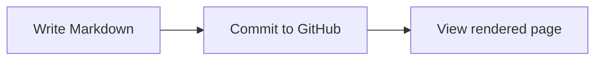

# GitHub Markdown Cheat Sheet

> A practical, copy-and-paste guide to **GitHub Flavored Markdown (GFM)**. This file is itself a working Markdown example: view it on GitHub to see how the syntax renders.

**How to use this guide:** Create a file ending in `.md` (for example, `README.md` or `docs/notes.md`), write plain text with the syntax below, commit it to your repository, and open it on GitHub. Every **Syntax** block shows exactly what to type; **Result** shows what GitHub displays when practical.

## Quick reference

| What you want | Markdown to type |
| --- | --- |
| Heading | `# Heading 1` / `## Heading 2` |
| **Bold** | `**bold**` |
| *Italic* | `*italic*` |
| ~~Strikethrough~~ | `~~deleted~~` |
| Inline code | `` `code` `` |
| Link | `[link text](https://example.com)` |
| Image | `` |
| Bullet | `- Item` |
| Numbered item | `1. Item` |
| Task | `- [ ] To do` / `- [x] Done` |
| Quote | `> Quoted text` |
| Horizontal rule | `---` |
| Table row | `| Left | Right |` |
| Emoji / status icon | `:rocket:` / `:white_check_mark:` |
| Error / warning | `:x:` / `:warning:` |

## Contents

1. [Headings](#1-headings)
2. [Paragraphs and line breaks](#2-paragraphs-and-line-breaks)
3. [Text formatting](#3-text-formatting)
4. [Horizontal rules](#4-horizontal-rules)
5. [Blockquotes](#5-blockquotes)
6. [Bullet and numbered lists](#6-bullet-and-numbered-lists)
7. [Task lists](#7-task-lists)
8. [Inline code and code blocks](#8-inline-code-and-code-blocks)
9. [Links and internal navigation](#9-links-and-internal-navigation)
10. [Images](#10-images)
11. [Tables](#11-tables)
12. [Escaping special characters](#12-escaping-special-characters)
13. [Automatic links and email links](#13-automatic-links-and-email-links)
14. [Emoji and status icons](#14-emoji-and-status-icons)
15. [Footnotes](#15-footnotes)
16. [GitHub alerts](#16-github-alerts)
17. [Collapsible sections](#17-collapsible-sections)
18. [HTML comments and basic HTML](#18-html-comments-and-basic-html)
19. [Mathematical expressions](#19-mathematical-expressions)
20. [Mermaid diagrams](#20-mermaid-diagrams)
21. [GitHub issue and pull request references](#21-github-issue-and-pull-request-references)
22. [Badges](#22-badges)
23. [Starter README template](#23-starter-readme-template)
24. [Good practices and common mistakes](#24-good-practices-and-common-mistakes)

---

## 1. Headings

Use one to six `#` signs, followed by a space. Use one `#` for a document title, `##` for major sections, and `###` for subsections.

**Syntax:**

```markdown
# Heading 1
## Heading 2
### Heading 3
#### Heading 4
##### Heading 5
###### Heading 6
```

GitHub makes headings linkable. For example, `[Jump to tables](#11-tables)` produces [Jump to tables](#11-tables).

## 2. Paragraphs and line breaks

A blank line starts a new paragraph. For a line break *inside* a paragraph, end a line with a backslash (`\`) or two trailing spaces.

**Syntax:**

```markdown
This is paragraph one.

This is paragraph two.

Line one\
Line two
```

**Result:**

This is paragraph one.

This is paragraph two.

Line one\
Line two

> **Tip:** Just pressing Enter once in the source usually does not create a visible line break in regular paragraph text.

## 3. Text formatting

**Syntax:**

```markdown
**Bold text**
*Italic text*
***Bold and italic***
~~Strikethrough text~~
H<sub>2</sub>O (subscript)
x<sup>2</sup> (superscript)
```

**Result:**

**Bold text** · *Italic text* · ***Bold and italic*** · ~~Strikethrough text~~

H<sub>2</sub>O (subscript) · x<sup>2</sup> (superscript)

You can also use underscores: `__bold__` and `_italic_`.

## 4. Horizontal rules

Use three or more hyphens, asterisks, or underscores on their own line.

**Syntax:**

```markdown
Text above

---

Text below
```

**Result:**

Text above

---

Text below

## 5. Blockquotes

Prefix quoted lines with `>`; nest quotes with `>>`.

**Syntax:**

```markdown
> A helpful quotation.
>
> A second paragraph in the quote.
>> A nested quotation.
```

**Result:**

> A helpful quotation.
>
> A second paragraph in the quote.
>> A nested quotation.

## 6. Bullet and numbered lists

Use `-`, `*`, or `+` for bullets, and `1.`, `2.`, etc. for ordered lists. Indent nested entries, typically with two or four spaces.

**Syntax:**

```markdown
- First bullet
- Second bullet
  - Nested bullet
  - Another nested bullet

1. First step
2. Second step
3. Third step

- Item with a paragraph

  Additional explanation under that item.
```

**Result:**

- First bullet
- Second bullet
  - Nested bullet
  - Another nested bullet

1. First step
2. Second step
3. Third step

## 7. Task lists

Use task lists to track work in issues, pull requests, and Markdown files. Put a space inside the brackets for incomplete tasks, or `x` for complete ones.

**Syntax:**

```markdown
- [x] Create repository
- [x] Add README.md
- [ ] Write documentation
- [ ] Publish first release
```

**Result:**

- [x] Create repository
- [x] Add README.md
- [ ] Write documentation
- [ ] Publish first release

> In repository Markdown files, these are visual checkboxes, not a replacement for an editable project tracker.

## 8. Inline code and code blocks

Wrap short code in single backticks: `` `git status` `` becomes `git status`.

For multiline code, use three backticks on separate lines. Add a language name, such as `python`, `bash`, `javascript`, or `json`, for syntax highlighting.

**Syntax:**

````markdown
```bash
git add .
git commit -m "Add documentation"
git push
```

```python
def greet(name):
    return f"Hello, {name}!"

print(greet("GitHub"))
```
````

**Result:**

```bash
git add .
git commit -m "Add documentation"
git push
```

```python
def greet(name):
    return f"Hello, {name}!"

print(greet("GitHub"))
```

> **Tip:** To show a fenced code block *as an example*, surround its triple-backtick fence with **four** backticks, as done above.

## 9. Links and internal navigation

Use `[label](destination)`. Prefer **relative paths** for links to other files in the same repository, so links work across branches and forks.

**Syntax:**

```markdown
[Visit GitHub](https://github.com)
[Open another document](docs/guide.md)
[Go up one folder](../README.md)
[Jump to the tables section](#11-tables)

[GitHub Docs][docs]

[docs]: https://docs.github.com/
```

**Working examples:** [Visit GitHub](https://github.com) · [Jump to tables](#11-tables) · [GitHub Docs](https://docs.github.com/)

`docs/guide.md` and `../README.md` are *example paths*: make sure the linked files exist relative to the Markdown file you are editing.

## 10. Images

Images use an exclamation mark before the link syntax. Write meaningful **alt text** for accessibility.

**Syntax:**

```markdown


[](https://example.com)
```

Recommended repository layout:

```text
my-project/
├── README.md
├── GITHUB_MARKDOWN_CHEATSHEET.md
└── images/
    └── screenshot.png
```

> The image paths above are illustrations. Add your own images to the repository and update the paths to match. The external image URL may change over time.

## 11. Tables

Separate columns with `|` and put a separator line of hyphens under the header. Use `:---` for left, `:---:` for center, and `---:` for right alignment.

**Syntax:**

```markdown
| Name | Role | Stars |
| :--- | :---: | ---: |
| Ada | Developer | 5 |
| Sam | Designer | 4 |
```

**Result:**

| Name | Role | Stars |
| :--- | :---: | ---: |
| Ada | Developer | 5 |
| Sam | Designer | 4 |

To include a literal pipe character in a table cell, escape it as `\|`. Markdown tables do not support merged cells by default.

## 12. Escaping special characters

Add a backslash before Markdown punctuation to print it literally instead of formatting it.

**Syntax:**

```markdown
\*This is not italic\*
\# This is not a heading
\[This is not a link\]
The symbols \* and \_ are shown literally.
```

**Result:**

\*This is not italic\*  
\# This is not a heading  
\[This is not a link\]

Other commonly escaped characters include `\`, `` ` ``, `{`, `}`, `(`, `)`, `!`, `+`, `-`, `.`, `>` and `|`.

## 13. Automatic links and email links

Wrap a URL or email address in angle brackets to make it an explicit link. Many plain URLs also become clickable automatically on GitHub.

**Syntax:**

```markdown
<https://github.com>
<hello@example.com>
[Email the team](mailto:hello@example.com)
```

**Result:**

<https://github.com> · <hello@example.com> · [Email the team](mailto:hello@example.com)

## 14. Emoji and status icons

GitHub supports emoji **shortcodes** (`:name:`), and you can also paste regular **Unicode emoji** directly into your Markdown. Both are useful for READMEs, changelogs, checklists, and project documentation.

**Basic syntax:**

```markdown
:rocket: :tada: :white_check_mark: :warning: :heart:

🚀 🎉 ✅ ⚠️ ❤️
```

**Result:**

:rocket: :tada: :white_check_mark: :warning: :heart:

### Status and utility icons

Copy either the **icon** or its **GitHub shortcode** into your Markdown. For clarity, include a word after status icons rather than relying on the symbol or color alone.

| Icon | Meaning / use | GitHub shortcode |
| :---: | --- | --- |
| ✅ | Success / passed / done | `:white_check_mark:` |
| ✔️ | Check / confirmed | `:heavy_check_mark:` |
| ☑️ | Checked item | `:ballot_box_with_check:` |
| 🆗 | OK / accepted | `:ok:` |
| 👍 | Approved / looks good | `:+1:` |
| ❌ | Error / failed / rejected | `:x:` |
| ⛔ | Blocked / prohibited | `:no_entry:` |
| ⚠️ | Warning / needs attention | `:warning:` |
| ℹ️ | Information / note | `:information_source:` |
| ❓ | Question / needs clarification | `:question:` |
| ⏳ | Pending / waiting | `:hourglass_flowing_sand:` |
| 🔄 | In progress / refreshing | `:arrows_counterclockwise:` |
| 🚧 | Work in progress | `:construction:` |
| 🟢 | Active / healthy / online | `:green_circle:` |
| 🟡 | Degraded / review needed | `:yellow_circle:` |
| 🔴 | Down / unhealthy / stopped | `:red_circle:` |
| 🐛 | Bug / defect | `:bug:` |
| 🧪 | Testing / experimental | `:test_tube:` |
| 🔒 | Secure / private / locked | `:lock:` |
| 🔓 | Unlocked / public | `:unlock:` |
| ✨ | New / improvement | `:sparkles:` |
| 📌 | Pinned / important | `:pushpin:` |
| 📦 | Package / release | `:package:` |
| 🚀 | Launched / deployed | `:rocket:` |
| 👀 | Under review | `:eyes:` |
| 📝 | Notes / documentation | `:memo:` |

> **Tip:** For a checkbox you can tick in a Markdown task list, use `- [x] Done` or `- [ ] To do` (see [Task lists](#7-task-lists)). A `✅` emoji is only a visual symbol; it is not an interactive task-list checkbox.

### Copy-paste examples for your repository

**Example 1: Release notes or feature status**

```markdown
## Project status

- ✅ Authentication: completed
- 🔄 API integration: in progress
- ⏳ Documentation: pending
- ⚠️ Search: experimental
- ❌ Legacy login: not supported
- ⛔ Mobile release: blocked by a dependency
```

**Result:**

- ✅ Authentication: completed
- 🔄 API integration: in progress
- ⏳ Documentation: pending
- ⚠️ Search: experimental
- ❌ Legacy login: not supported
- ⛔ Mobile release: blocked by a dependency

**Example 2: Status table**

```markdown
| Component | Status | Notes |
| --- | --- | --- |
| Website | ✅ Healthy | Available |
| API | ⚠️ Degraded | Elevated latency |
| Payments | ❌ Down | Under investigation |
| New dashboard | 🚧 In progress | Not yet released |
```

**Result:**

| Component | Status | Notes |
| --- | --- | --- |
| Website | ✅ Healthy | Available |
| API | ⚠️ Degraded | Elevated latency |
| Payments | ❌ Down | Under investigation |
| New dashboard | 🚧 In progress | Not yet released |

**Example 3: Shortcodes instead of pasted emojis**

```markdown
:white_check_mark: Tests passed  
:x: Build failed  
:warning: Requires manual review  
:information_source: Read the setup instructions
```

**Result:**

:white_check_mark: Tests passed  
:x: Build failed  
:warning: Requires manual review  
:information_source: Read the setup instructions

**Example 4: Combine GitHub alerts with icons**

```markdown
> [!WARNING]
> ⚠️ This feature is experimental.

> [!TIP]
> ✅ Run tests before opening a pull request.
```

> [!WARNING]
> ⚠️ This feature is experimental.

> [!TIP]
> ✅ Run tests before opening a pull request.

**Compatibility:** Shortcodes such as `:white_check_mark:` are expanded when GitHub renders Markdown, but other Markdown viewers may show the shortcode literally. Unicode icons usually travel better between platforms, although their appearance varies by device and font. Icons and status labels in these examples are illustrative, not live health checks.

For a searchable list of additional codes, see [GitHub's emoji cheat sheet](https://github.com/ikatyang/emoji-cheat-sheet).

## 15. Footnotes

Use a named reference in your paragraph and a corresponding definition anywhere in the file. GitHub renders the footnotes at the end.

**Syntax:**

```markdown
Markdown is easy to learn.[^learn]

[^learn]: You can edit Markdown using any plain-text editor.
```

**Result:**

Markdown is easy to learn.[^learn]

[^learn]: You can edit Markdown using any plain-text editor.

## 16. GitHub alerts

GitHub has five special callout styles: `NOTE`, `TIP`, `IMPORTANT`, `WARNING`, and `CAUTION`. They start with a blockquote marker and a keyword.

**Syntax:**

```markdown
> [!NOTE]
> Background information.

> [!TIP]
> A useful shortcut.

> [!IMPORTANT]
> Essential instructions.

> [!WARNING]
> Something that needs attention.

> [!CAUTION]
> A risk or possible negative consequence.
```

**Result (one example):**

> [!TIP]
> Preview your Markdown on GitHub before merging it.

Use callouts sparingly in real documentation. They may appear differently in editors that do not support GitHub's alert extension.

## 17. Collapsible sections

GitHub supports the HTML `<details>` and `<summary>` elements for optional, expandable content.

**Syntax:**

````markdown
<details>
<summary>Click to show more</summary>

Hidden explanation goes here.

```bash
echo "Hello!"
```

</details>
````

**Result:**

<details>
<summary>Click to show more</summary>

Hidden explanation goes here.

```bash
echo "Hello!"
```

</details>

To leave it expanded initially, use `<details open>`.

## 18. HTML comments and basic HTML

You can add invisible comments and use some simple HTML when Markdown alone is insufficient. GitHub sanitizes HTML; scripts, custom CSS, and arbitrary interactive HTML are not supported.

**Syntax:**

```html
<!-- TODO: Add a screenshot later. -->

<p align="center">Centered text</p>

Line one<br>
Line two
```

The comment is invisible in the rendered page but remains visible when someone edits or views the raw `.md` file.

## 19. Mathematical expressions

GitHub Markdown can render LaTeX-style math using MathJax. Use `$...$` for inline math and `$$...$$` for display math.

**Syntax:**

```markdown
Einstein's equation is $E = mc^2$.

$$
a^2 + b^2 = c^2
$$
```

**Result:**

Einstein's equation is $E = mc^2$.

$$
a^2 + b^2 = c^2
$$

## 20. Mermaid diagrams

Put [Mermaid](https://mermaid.js.org/) diagram syntax in a fenced code block marked `mermaid`. GitHub will render it as a diagram.

**Syntax:**

````markdown

````

**Result:**


GitHub also supports other diagram formats; Mermaid is a good starting point for flowcharts and sequence diagrams.

## 21. GitHub issue and pull request references

GitHub can automatically link issue numbers, pull requests, commit identifiers, and mentions in supported contexts. Replace the placeholders with real values.

**Examples (do not paste the placeholders literally):**

```text
#123                         Issue or pull request in the current repo
owner/repository#123         Issue or pull request in another repo
@USERNAME                    Mention a user
@ORG/TEAM                    Mention a team
Closes #123                  Often used in a pull request description
```

> Mentions and references may have different effects depending on whether you put them in an `.md` file, issue, pull request, or comment. Avoid tagging real people just to demonstrate the syntax.

## 22. Badges

Badges are small images frequently used in READMEs to display build status, licenses, or project information. They are typically loaded from an external badge provider.

**Syntax:**

```markdown


[](https://example.com/docs)


```

> These use [Shields.io](https://shields.io/) and require an internet connection. **The examples above are static badges, not automatically updated build results.** Replace labels, destinations, and status information with accurate project details. For live build status, use a badge tied to your CI provider.

## 23. Starter README template

Copy the following into a new `README.md` and customize the placeholders.

**Syntax:**

````markdown
# Project Name

A short, clear description of what this project does.

## Features

- Feature one
- Feature two
- Feature three

## Installation

```bash
git clone https://github.com/USERNAME/REPOSITORY.git
cd REPOSITORY
```

## Usage

Explain how to run or use the project.

## Project structure

- `src/` — source code
- `docs/` — documentation
- `tests/` — tests

## Status

✅ Core features ready  
🚧 Documentation in progress  
⚠️ API is experimental

## Roadmap

- [x] Create the project
- [ ] Add tests
- [ ] Publish a release

## Contributing

Contributions are welcome. Explain how to suggest changes.

## License

Add the name of your actual project license here.
````

## 24. Good practices and common mistakes

- Name your main documentation file **`README.md`** so GitHub can display it on your repository homepage.
- Put a space after `#`, `-`, `>`, and ordered-list markers: write `## Heading`, not `##Heading`.
- Use only one top-level `#` title per document when practical; structure the rest with `##` and `###`.
- Leave blank lines around headings, lists, tables, and fenced code blocks for readability.
- Keep relative links accurate: `images/logo.png` is resolved relative to the Markdown file's directory.
- Give images descriptive alternative text and links meaningful labels (avoid only saying "click here").
- Put a language after code fences for readable syntax highlighting.
- Do not put sensitive information such as passwords or API keys in Markdown files you commit.
- Verify the **Preview** on GitHub: some Markdown features render differently in local editors.
- Remember that `README.md` uses **GitHub Flavored Markdown**; other Markdown renderers may not support GitHub alerts, Mermaid, task lists, or math identically.

---

## Official references

- [GitHub: Basic writing and formatting syntax](https://docs.github.com/en/get-started/writing-on-github/getting-started-with-writing-and-formatting-on-github/basic-writing-and-formatting-syntax)
- [GitHub: Working with advanced formatting](https://docs.github.com/en/get-started/writing-on-github/working-with-advanced-formatting)
- [GitHub: Creating and highlighting code blocks](https://docs.github.com/en/get-started/writing-on-github/working-with-advanced-formatting/creating-and-highlighting-code-blocks)
- [GitHub: Creating diagrams](https://docs.github.com/en/get-started/writing-on-github/working-with-advanced-formatting/creating-diagrams)
- [GitHub Flavored Markdown specification](https://github.github.com/gfm/)

---

*Keep this file as a reference in your repository, for example at `docs/GITHUB_MARKDOWN_CHEATSHEET.md`. If you move it into `docs/`, remember that its example relative paths will then be relative to that folder.*
